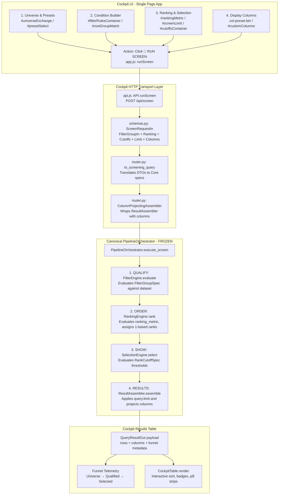

# YOGI — BATCH U2 TARGETED UX & SOURCE EXPOSURE AUDIT
## Screening & Configuration Workspace

**Mode:** STRICTLY READ-ONLY AUDIT  
**Date:** 2026-09-29  
**Status:** COMPLETE  
**Reference Codebase:** `D:\Yogi Investing\My_version`  
**Reference Prototype:** `D:\Yogi Investing\yogi_engine\yogi_engine`  
**Baseline Test Suite:** 568 passed / 568 tests (100% passing)

---

## 1. Executive Summary

This audit evaluates the **Screening and Configuration Workspace** of YOGI Cockpit to determine the most coherent, professional way to expose the already-existing backend capabilities to a professional investor under the design constitution:

> **FULL CONTROL WITHOUT COMPLEXITY • ONE UNIFIED WORKSPACE • PROGRESSIVE DISCLOSURE**

### Key Findings:
1. **The Backend Engine is Complete & Frozen**: The backend canonical screening pipeline (`QUALIFY → ORDER → SHOW → LIMIT → RESULTS`) and its four underlying engines (`FilterEngine`, `RankingEngine`, `SelectionEngine`, `ResultAssembler`) already support 100% of the required capabilities:
   - Nested boolean logic trees (`ALL` / `ANY`) to arbitrary depth
   - Rule-level and group-level negation (`NOT`)
   - Cross-field column comparisons (`field2`, e.g. `MROC > WROC`)
   - 12 comprehensive filter operators
   - Multi-timeframe metrics across 6 timeframes (`D, W, M, Q, H, Y`)
   - 204 candlestick shape & pattern flags
   - Ordinal cohort ranking and rank-based survival cutoffs (`RankCutoffSpec`)
2. **The Core UI Problem is Presentation, Not Capability**: The backend is rich and flexible, but the Cockpit condition builder presents it either too coarsely (flat, hardcoded dropdowns omitting candlestick and multi-timeframe DMI fields) or clunkily (hidden `<details>` tags for rank cutoffs, unstyled nested groups).
3. **No Dual / Triple Modes**: There is **no need** for separate "Quick Mode", "Custom Mode", or "Advanced Mode". A single, unified, progressive-disclosure workspace satisfies casual screening, preset execution, and advanced institutional-grade rule composition simultaneously.
4. **Zero Computation in Frontend**: All filtering, ranking, cutoffs, and limits remain 100% backend-owned and executed through `PipelineOrchestrator.execute_screen()`.

---

## 2. Current Screening Execution Path

Tracing the actual runtime flow from user interaction to presentation:



### Trace Details:
- **Files Involved**:
  - `src/yogi/cockpit/static/index.html`: Workbench controls
  - `src/yogi/cockpit/static/js/app.js`: `buildScreenPayload()`, `runScreen()`, `extractFilterGroup()`
  - `src/yogi/cockpit/static/js/api.js`: `API.runScreen()`
  - `src/yogi/cockpit/router.py`: `run_screen()`
  - `src/yogi/cockpit/schemas.py`: `ScreenRequestIn`, `FilterGroupIn`, `FilterRuleIn`, `RankCutoffIn`, `to_screening_query()`
  - `src/yogi/core/configuration/query.py`: `ScreeningQuery`
  - `src/yogi/core/orchestration/pipeline.py`: `PipelineOrchestrator.execute_screen()`
  - `src/yogi/filter/engine.py`: `FilterEngine`
  - `src/yogi/ranking/engine.py`: `RankingEngine`
  - `src/yogi/selection/engine.py`: `SelectionEngine`
  - `src/yogi/results/assembler.py`: `ResultAssembler`
  - `src/yogi/cockpit/static/js/table.js`: `CockpitTable.render()`
- **Pipeline Authority**: `PipelineOrchestrator` remains 100% authoritative. Zero client-side filtering or ranking occurs before or during screen execution.

---

## 3. Capability Inventory

| Capability Domain | Specific Feature | Backend Status | Implementation Details |
|---|---|---|---|
| **Conditions** | Single-field rule | Complete | `FilterRuleSpec(field, op, value)` |
| | Multiple conditions | Complete | `FilterGroupSpec(rules=[...])` |
| | AND / OR logic | Complete | `FilterGroupSpec(match="all" \| "any")` |
| | Nested groups | Complete | Arbitrary recursion in `FilterGroupSpec.rules` |
| | NOT / Negation | Complete | `FilterRuleSpec.is_negated` & `FilterGroupSpec.is_negated` |
| | Cross-field comparison | Complete | `FilterRuleSpec.field2` (e.g. `MROC > WROC`) |
| | 12 Operators | Complete | `>`, `>=`, `<`, `<=`, `==`, `!=`, `in`, `not_in`, `between`, `blank`, `not_blank`, `contains` |
| | Enums / Categoricals | Complete | `BANDST_*` (`ABOVE`, `IN`, `BELOW`), `EMA_*` (`upcut`, `yes`, `downcut`, `no`), `IC` (`IP`, `CR`, `up`), `DMI_STATE_*` |
| | Numerics / Percentages | Complete | Floats, ints, negative values, decimals |
| | Candlestick patterns | Complete | 204 pattern flags computed by `CandleCalculator` (`CD_*`, `CW_*`, `CM_*`, `CQ_*`, `CH_*`, `CY_*`) |
| | Multi-timeframe DMI | Complete | `ADX_*`, `DIP_*`, `DIM_*`, `DMI_STATE_*` across all 6 timeframes |
| **Ranking** | Primary metric | Complete | `ScreeningQuery.ranking_metric` |
| | Direction (Asc/Desc) | Complete | `RankingOrder.DESCENDING` and `ASCENDING` |
| | Tie-breaking standard | Complete | `RankingMethod.MIN` (prototype tie standard), secondary symbol tie-breaker |
| | Secondary metric ranking | Client-side only | Table-level sort in `table.js`; Core `RankingEngine` has symbol fallback |
| | Dynamic cohort ranking | Complete | Backend computes relative rank and injects `RANK_{metric}` |
| **Selection** | Display limit (Top N) | Complete | `ScreeningQuery.limit` applied as row cap |
| | Rank Cutoff rules | Complete | `RankCutoffSpec(rank_metric, max_rank, min_periods)` in `SelectionEngine` |
| | Sustained rank duration | Complete | `min_periods` in `RankCutoffSpec` |
| **Presets** | 21 Mentor Presets | Complete | Group A (Impulse), B (Sprint), C (Bands), D (Exits), E (Ranking) in `presets.py` |
| | Editable starting recipe | Complete | Presets load into form controls; modifications tracked via `(Modified)` |
| | User-created presets | Complete | Save As modal, persistence in `data/user_presets.json` |
| | Preset lifecycle | Complete | List, load, save, overwrite, delete via `/api/user-presets` |
| **Results** | Configurable columns | Complete | `ColumnProjectingAssembler` projects arbitrary requested columns |
| | Column presets | Complete | 7 built-in presets (`Default`, `Returns`, `Sprints`, `Bands`, `EMAs`, `Strength`, `All`) |
| | Visual telemetry strips | Complete | 6-TF EMA strip, 6-TF Band strip, Impulse badges, ROC color coding |
| | Funnel telemetry | Complete | `Universe → Qualified → Selected` |
| | Export | Complete | Streaming XLSX (styled openpyxl), RFC 4180 CSV, formatted JSON |

---

## 4. Capability → Contract → API → UI Map

Classification Schema:
- **A. USER-FACING**: Fully exposed and usable in UI today.
- **B. PARTIALLY EXPOSED**: Present in backend and partially in UI, but clunky or limited.
- **C. BACKEND PRESENT — UI MISSING**: Fully supported in Core contracts & engine, but absent from UI.
- **D. PRESENT BUT POORLY ORGANIZED**: Exposed in UI, but disorganized or confusing.
- **E. GENUINELY MISSING BACKEND**: Not implemented in backend.
- **F. DEFERRED**: Intentionally postponed by architecture or prior ADRs.
- **G. UNVERIFIED**: Needs verification.

| # | Backend Capability | Contract / Module | API Schema / Path | Current UI State | Class |
|---|---|---|---|---|:---:|
| 1 | Boolean Qualification (`ALL` / `ANY`) | `FilterGroupSpec` / `FilterEngine` | `FilterGroupIn.match` / `/api/screen` | Root match dropdown `#rootGroupMatch` | **A** |
| 2 | Nested Groups (Recursive) | `FilterGroupSpec.rules` | `FilterGroupIn.rules` / `/api/screen` | Button `+ Add Nested Group` exists, but lacks visual hierarchy / nesting depth styling | **B** |
| 3 | Rule Negation (`NOT`) | `FilterRuleSpec.is_negated` | `FilterRuleIn.is_negated` | `.rule-not-toggle` button in rule row | **A** |
| 4 | Group Negation (`NOT Group`) | `FilterGroupSpec.is_negated` | `FilterGroupIn.is_negated` | Backend supports; UI has no group-level NOT toggle | **C** |
| 5 | Cross-Field (`field2`) Comparison | `FilterRuleSpec.field2` | `FilterRuleIn.field2` | `.rule-mode-toggle` ("vs Col") exists, but shows flat raw list | **D** |
| 6 | 12 Filter Operators | `FilterOperator` / `FilterEngine` | `FilterOperator` enum | 11 operators in `.rule-op-select` (missing `contains`) | **B** |
| 7 | Candlestick Shape / Pattern Flags | `CandleCalculator` (204 metrics) | `CalculationResult.metrics` | Entirely absent from `METRICS_CATALOG` in `app.js` | **C** |
| 8 | Multi-Timeframe DMI (W, M, Q, H, Y) | `TrendCalculator` | `CalculationResult.metrics` | `app.js` only exposes Daily DMI (`ADX_D`, `DIP_D`, `DIM_D`) | **C** |
| 9 | Primary Ranking Metric & Order | `RankingEngine` | `ScreenRequestIn.ranking_metric/order` | `#rankingMetric` and `#rankingOrder` dropdowns | **A** |
| 10 | Secondary Ranking in Core | Hardcoded symbol tie-breaker | Not in `ScreenRequestIn` | Table-level sort only in `table.js` | **B** |
| 11 | Selection Top N Limit | `PipelineOrchestrator` row slice | `ScreenRequestIn.limit` | Limit pills (`Top 10..100`) and number input | **A** |
| 12 | Cohort Survival Rank Cutoffs | `SelectionEngine` / `RankCutoffSpec` | `ScreenRequestIn.selection_cutoffs` | Hidden in `<details>` disclosure with only 3 hardcoded choices | **D** |
| 13 | 21 Mentor Presets as Recipes | `StrategyCatalog` / `presets.py` | `GET /api/strategies`, `/api/strategies/{name}` | `#presetSelect` dropdown with categories, `#loadPresetBtn` | **A** |
| 14 | User Preset Persistence | `AppState` / `user_presets.json` | `POST /api/user-presets`, `DELETE` | Save As modal, list, delete | **A** |
| 15 | Quick 1-Click EMA Toggles | `FilterEngine` (`EMA_{tf}`) | Embedded in `FilterGroupIn` | 6 toggle pills `[D] [W] [M] [Q] [H] [Y]` | **A** |
| 16 | Quick Band Position Shortcuts | `FilterEngine` (`BANDST_M`, etc.) | Embedded in `FilterGroupIn` | 3 buttons (`+ Above Monthly`, `+ Outside 2+ TF`, `+ Reaction`) | **A** |
| 17 | Segment Filtering (F&O / Cash) | `FilterRuleSpec(field="fno")` | Embedded in `FilterGroupIn` | `#universeSegment` dropdown in Step 1 | **A** |
| 18 | Multi-Month Rank Archive Curve | Not implemented | `/api/rankhistory/{symbol}` | Deferred in roadmap | **F** |
| 19 | Global DMI Parameter Tuning | In-memory only | `/api/dmi/settings` | Deferred in roadmap | **F** |

---

## 5. Condition Builder Audit

### Current Limitations:
1. **Metric Selection Lacks Inline Timeframe**: Currently, the metric selector conflates the metric family and the timeframe into raw keys (`M_CUR`, `DROC`, `WROC`, `MROC`, `QROC`, `HROC`, `YROC`). An investor wanting Weekly ROC must know the abbreviation `WROC` rather than picking "Rate of Change" and selecting `[W]`.
2. **Missing Backend Metrics in Picker**:
   - Candlestick patterns (`BULL_ENGULF`, `DOJI`, `HAMMER`, `MARUBOZU`, `BREAKOUT`) across all timeframes are omitted from `METRICS_CATALOG`.
   - Higher-timeframe DMI/ADX (`ADX_W`, `ADX_M`, `DMI_STATE_W`, `DMI_STATE_M`) are omitted.
3. **Clunky Cross-Field Mode**: The "vs Col" button toggles the entire input without visual indication of comparison semantics (e.g. `Metric 1 > Metric 2`).
4. **Weak Nested Group Ergonomics**: Nested groups look like flat grey boxes without clear indentation or tree connectors, making complex screens hard to read.

### Recommended Condition Builder Model:
```text
+---------------------------------------------------------------------------------------------------+
| [Metric Family ▾]   [TF: D | W | M | Q | H | Y]   [Operator ▾]   [Value / ⇄ vs Metric]  [NOT] [✕] |
+---------------------------------------------------------------------------------------------------+
```
- **Step 1: Metric Family**: Searchable, categorized picker (e.g. `Rate of Change`, `Sprint Speed`, `Band State`, `EMA Ribbon`, `Impulse`, `DMI / ADX`, `Candle Pattern`).
- **Step 2: Timeframe Segmented Control**: If the metric family is multi-timeframe, renders a 6-button segmented control: `[D] [W] [M*] [Q] [H] [Y]`. Selecting `[M]` sets the internal key to `MROC` (or `M_CUR`).
- **Step 3: Operator**: Context-sensitive (`>`, `>=`, `<`, `<=`, `==`, `!=`, `in`, `between`).
- **Step 4: Value / Comparison**:
  - If Enum: Dropdown of legal values (`ABOVE / IN / BELOW` for Bands; `upcut / yes / downcut / no` for EMA; `bullish / bearish / neutral` for DMI).
  - If Numeric: Clean text input with unit hint (`%`, `₹`, `Cr`, `pts`).
  - If Cross-Field: Toggle button `[⇄ vs Col]` switches to a second metric selector.
- **Step 5: NOT Toggle**: Visual inversion pill.

---

## 6. Ranking vs Selection Audit

### The Conceptual Distinction:
| Dimension | RANKING ("Where does it stand?") | SELECTION ("Does its rank qualify?") |
|---|---|---|
| **Authoritative Contract** | `IRankingRule` (`src/yogi/ranking/`) | `ISelectionRule` (`src/yogi/selection/`) + `ScreeningQuery.limit` |
| **Pipeline Stage** | **Stage 2: ORDER** | **Stage 3: SHOW** (and Stage 4 LIMIT) |
| **Purpose** | Orders 100% of qualified candidates relative to each other | Filters out candidates based on ordinal thresholds and limits |
| **Record Count Effect** | Never drops records (`count_in == count_out`) | Reduces record count (`count_out <= count_in`) |
| **User Question** | *"Sort by highest Monthly Return"* | *"Keep only stocks ranked in the Top 100 this year, then show Top 25"* |

### Current UI Defect:
- In `index.html`, Ranking and Selection are lumped together under **Step 4: Ranking & Selection**.
- The primary ranking dropdown and "Select Top N" input sit side-by-side, blurring the fact that `Top N` is a presentation row cap, while `RankCutoffSpec` (e.g. `RANK_M <= 100`) is an analytical survival rule.
- Rank Cutoffs are hidden inside a collapsed `<details>` element labeled "Advanced Ranking & Cutoffs", and the dropdown only contains 3 hardcoded metrics (`RANK_M`, `RANK_Y`, `RANK_W`).

### Recommended Separation:
- **Card 3: Ranking (ORDER)**:
  - `Primary Ranking Metric`: [ Monthly Return (M_CUR) ▾ ]
  - `Direction`: [ Descending (Highest #1) ▾ ]
  - `Tie-Breaker`: [ Symbol Ascending (Default) ▾ ] (with progressive disclosure for secondary metric)
- **Card 4: Selection (SHOW)**:
  - `Result Limit`: Quick selection pills: `[10] [20*] [50] [100] [All]` + numeric input.
  - `Rank Survival Cutoffs`: Clean, visible chip builder: `[ + Add Rank Threshold ]` allowing `[ Metric Rank ▾ ] ≤ [ Threshold ]`.

---

## 7. Preset / Strategy UX Audit

### Current Behavior:
- When a user selects a preset from `#presetSelect` and clicks `#loadPresetBtn`:
  - `applyPresetToEditor(name)` fetches `StrategyDetailOut` from `/api/strategies/{name}`.
  - Recursively populates `filterRulesContainer`.
  - Sets root group match (`all` / `any`).
  - Sets ranking metric and limit.
  - Synchronizes 1-click EMA quick toggles.
  - Sets banner to `Preset: <Name>`.
- When the user edits any condition:
  - `isPresetModified = true`.
  - Banner updates to `Preset: <Name> (Modified)`.
- When the user clicks "Save As...":
  - Modal opens, user provides a new name, and `API.saveUserPreset()` saves it to `user_presets.json`.

### Recommended Enhancements:
- **Instant 1-Click Load**: Remove the redundant `#loadPresetBtn`. Selecting a preset from the dropdown should immediately populate the workspace.
- **Revert / Reset Button**: Add a "Revert to Preset" action when modified, allowing the user to restore the original preset recipe with one click.
- **Duplicate / Rename**: Expose clear actions in the User Presets section.

---

## 8. Result Table Audit

### Current Strengths:
- **High Information Density**: Compact rows (26px height), clean borders, dark theme matching prototype.
- **Visual Pill Strips**:
  - `EMA_STRIP`: 6 pills `D W M Q H Y` showing green (`UP` / `UPCUT`), red (`DOWN` / `DOWNCUT`), or grey (`na`).
  - `BAND_STRIP`: 6 pills showing blue (`ABOVE`), orange (`BELOW`), or grey (`IN`).
  - Impulse badges: `IMPULSE` (green), `CORRECT` (red).
  - DMI badges: `BULLISH` (green), `BEARISH` (red), `NEUTRAL` (grey).
- **Interactive Sorting & Filtering**: Instant client-side text filter and header click-to-sort with indicator arrows (`▲` / `▼`).
- **Drawer Integration**: Clicking any row smoothly opens the Batch U1 Stock Detail Drawer.

### Areas for Improvement:
- **Custom Column Editor**: Currently a comma-separated text input (`#customColumns`). Replace with a clean multi-select popover/modal that groups available columns by category (`Returns`, `Sprints`, `Bands`, `EMAs`, `Strength`, `Metadata`).
- **Column Header Grouping**: Group related headers visually (e.g. `RETURNS (D, W, M, Y)`).

---

## 9. Prototype Workflow Parity

| Prototype Workflow | Prototype Location | Modern YOGI Equivalent | Disposition |
|---|---|---|---|
| **1-Click EMA Up Checkboxes** | `#listBar`: `e_D`, `e_W`, `e_M`, `e_Q`, `e_H`, `e_Y` | `#emaQuickToggles` button strip | **PRESERVE & ENHANCE** (maintain quick 1-click toggling) |
| **Month / Year Rank Top 100** | `#listBar`: `f_mrank`, `f_yrank` (`#mrankmax`, `#yrankmax`) | `RankCutoffSpec` in `SelectionEngine` | **RE-EXPRESS** as clean rank cutoff controls in Selection section |
| **Rank Filter Panel** | `#rankPanel`: ALL/ANY ticked periods ranked <= N | `SelectionEngine.select(cutoffs, mode)` | **PROGRESSIVELY DISCLOSE** in Selection card |
| **Curated Lists Dropdown** | `#curated`: 21 mentor strategies | `#presetSelect`: Categorized mentor presets | **PRESERVE** (already matches prototype 100%) |
| **Category Filter** | `f_fno` (F&O, Cash, ETF, SME, REIT) | `#universeSegment` + `InstrumentClassifier` | **PRESERVE & EXTEND** to SME/ETF if needed |
| **Dual View Mode (List vs Table)** | `vList` vs `vTable` (AG-Grid) | Single unified Cockpit table | **RE-EXPRESS**: Modern YOGI table combines the speed of List with the depth of Table |
| **Spreadsheet Color Highlights** | Prototype CSS heatmap (`.pos`, `.neg`, `.up`, `.dn`) | `table.js` cell formatting | **PRESERVE** |

---

## 10. Recommended Unified Control Hierarchy

The layout remains **ONE unified Cockpit** with a structured, vertical left workbench (or collapsible sidebar) and a prominent results viewport:

```text
====================================================================================================
YOGI COCKPIT — UNIFIED SCREENING WORKBENCH
====================================================================================================

LEFT WORKBENCH (Accordion or Structured Cards)          RIGHT RESULTS VIEWPORT
--------------------------------------------------      --------------------------------------------
[ CARD 1: UNIVERSE & PRESETS ]                          [ ACTIVE SETUP BANNER ]
  - Exchange: [ NSE ▾ ]  Segment: [ All Equities ▾ ]      Universe: NSE · Preset: A1_IMPULSE · Top 20
  - Preset: [ -- Choose Preset (21 Mentor/User) ▾ ]
  - Actions: [ Save As... ] [ Reset ]                   [ FUNNEL TELEMETRY ]
                                                          Universe: 2000 → Qualified: 84 → Selected: 20
[ CARD 2: CONDITIONS (QUALIFY) ]
  - Quick Toggles:                                      [ RESULTS GRID (High Density) ]
      EMA Up: [D] [W] [M] [Q] [H] [Y]                     Symbol | Price | Return | S4 | Accel | Bands
      Bands : [+ Above M] [+ Outside 2+ TF]               INFY   | 1850  | +8.2%  | 3.1| +1.2 | ABOVE
  - Match: [ ALL Conditions (AND) ▾ ]                     TCS    | 4120  | +5.4%  | 2.8| +0.8 | IN
  - Dynamic Condition Rows:                               SBIN   |  810  | +6.1%  | 2.9| +0.5 | ABOVE
      [Metric ▾] [TF] [Op ▾] [Value / vs Col] [✕]
  - [ + Add Condition ]  [ + Add Nested Group ]

[ CARD 3: RANKING (ORDER) ]
  - Primary: [ Current Month Return (M_CUR) ▾ ]
  - Direction: [ Descending (Highest #1) ▾ ]
  - [▸ Advanced Tie-Breaker]

[ CARD 4: SELECTION (SHOW) ]
  - Show: [ Top 20 ▾ ]  ([10] [20] [50] [100] [All])
  - [▸ Rank Cutoffs (Survival)]: [ RANK_M ≤ 100 ]

[ CARD 5: COLUMNS & ACTIONS ]
  - Columns: [ Default ▾ ] [ Customize... ]
  - [ 🚀 RUN SCREEN ]
  - Export: [ XLSX ] [ CSV ] [ JSON ]
====================================================================================================
```

---

## 11. Recommended Progressive Disclosure

To prevent a "control explosion" while giving advanced investors full power:

| Section | Default Visible (Immediate) | Disclosed on Interaction / Click |
|---|---|---|
| **Universe** | Exchange (`NSE`), Segment (`All Equities`) | Quick Symbol Search |
| **Presets** | Dropdown with categorized recipes | Save As modal, Preset Description |
| **Conditions** | Quick EMA ribbon, Quick Band buttons, Root Match (`ALL`), Add Condition button | Operator choices, Enum dropdowns, `[⇄ vs Col]` cross-comparison, `[NOT]` inversion pill, Nested Group cards |
| **Ranking** | Primary Metric, Sort Direction (`Desc` / `Asc`) | Secondary Tie-Breaker metric |
| **Selection** | Top N Quick Pills (`10`, `20`, `50`, `100`, `All`) | Rank Cutoff chip builder (`RANK_M <= 100`) |
| **Columns** | Preset views (`Default`, `Returns`, `Sprints`, etc.) | Custom column selection popover |
| **Results** | Dense table with pill strips, sort headers, filter search | Stock Detail Drawer on row click |

---

## 12. Exact Implementation Files (Batch U2)

The implementation of Batch U2 will be strictly confined to the Cockpit presentation layer:

1. **`src/yogi/cockpit/static/index.html`**:
   - Reorganize workbench into the 5 structured cards.
   - Refactor condition builder row templates with segmented timeframe controls.
   - Upgrade Rank Cutoffs container styling.
2. **`src/yogi/cockpit/static/css/cockpit.css`**:
   - Nested group tree indentation styling (`border-left` connectors).
   - Segmented timeframe button styles (`.tf-segmented-control`).
   - Cross-field comparison badge styling.
   - Rank cutoff chip styles.
3. **`src/yogi/cockpit/static/js/app.js`**:
   - Expand `METRICS_CATALOG` to include candlestick patterns and multi-timeframe DMI metrics.
   - Implement metric family + inline timeframe resolver (`getMetricKey(family, tf)`).
   - Enhance `createRuleRow()` with inline timeframe selector, context-sensitive value inputs, and clear `vs Col` comparison.
   - Enhance `createNestedGroupCard()` with visual tree hierarchy and group-level NOT toggle.
   - Separate Ranking from Selection state.
4. **`src/yogi/cockpit/static/js/table.js`**:
   - Add column formatting for candlestick pattern flags (`BULL_ENGULF`, `DOJI`, etc.).
   - Support column grouping headers if required.
5. **`tests/cockpit/test_batch_u2_screener.py`**:
   - New dedicated test suite verifying screen serialization, nested groups, cross-column comparisons, rank cutoffs, and preset roundtripping.

---

## 13. Files That Must Remain Frozen

Per `AGENTS.md`, the following directories and components are **FROZEN** and must **NOT** be modified:

- `src/yogi/core/*` (Contracts, Registry, Configuration, Orchestration)
- `src/yogi/calculation/*` (Bands, Velocity, Impulse, Trend, Candles)
- `src/yogi/filter/*` (FilterEngine)
- `src/yogi/ranking/*` (RankingEngine)
- `src/yogi/selection/*` (SelectionEngine)
- `src/yogi/strategy/*` (Strategy engine and mentor presets)
- `src/yogi/timeframe/*` (TimeframeEngine)
- `src/yogi/data/*` (Normalizers, Yahoo, Zerodha, Twelve Data, Demo)
- `src/yogi/storage/*` (CsvBandsRepository, CsvMetadataRepository)
- `src/yogi/results/assembler.py` and `formatter.py`

All mathematical, filtering, and screening capabilities already exist in these frozen modules.

---

## 14. U2 Implementation Scope

### In Scope:
1. **Unified Screener Layout**: Restructure Workbench into the 5 coherent progressive-disclosure sections (`Universe`, `Presets`, `Conditions`, `Ranking`, `Selection`).
2. **Enhanced Condition Builder**:
   - Categorized, searchable metric family picker.
   - Inline multi-timeframe segmented control (`[D] [W] [M] [Q] [H] [Y]`).
   - Clean cross-field comparison (`[⇄ vs Metric]`).
   - Rule-level and group-level `[NOT]` toggles.
   - Visually indented nested group cards with tree connectors.
3. **Expanded Metric Catalog**: Expose candlestick pattern flags and multi-timeframe DMI fields in Cockpit frontend.
4. **Clean Separation of Ranking and Selection**:
   - Dedicated Ranking card (Primary metric, Direction, Secondary tie-breaker).
   - Dedicated Selection card (Top N pills + explicit Rank Cutoff threshold chips).
5. **Preset Ergonomics**:
   - Instant 1-click loading.
   - Modified setup tracking with "Revert" shortcut.
   - Save As modal enhancements.
6. **Result Table Column Picker**:
   - Multi-select popover/modal replacing raw text comma string.
7. **Test Suite**:
   - 100% pass rate on all 568 pre-existing tests + new Batch U2 screener tests.

---

## 15. Explicit Out-of-Scope Items

The following are strictly **EXCLUDED** from Batch U2:

1. **No Backend Calculation Changes**: No modifications to math in `src/yogi/calculation/`.
2. **No Frontend Financial Calculations**: Zero indicators, returns, or technical math in JavaScript.
3. **No Secondary Multi-Metric Engine in Core**: Core `RankingEngine` contract remains frozen; secondary ranking remains presentation tie-breaking.
4. **No Cold SQL/Timescale Database Persistence**: Cold price database remains deferred to operations phase (Step 12).
5. **No WebSocket / Real-Time Streaming Ticks**: Hot path streaming remains deferred to Step 12.
6. **No Broker Order Execution**: Order placement is out of scope.

---

## 16. Acceptance Criteria

When Batch U2 is implemented, it must satisfy:

1. **Zero Button Farm**: No flat row of 50 independent buttons. All controls grouped under the 5 progressive-disclosure cards.
2. **Final Design Test Execution**: A user must be able to construct and run the complex momentum screen from Section 16 of the audit prompt without writing code or JSON.
3. **Async & Screening State Isolation**: Changing chart timeframe or drawer controls must not alter active screening conditions or query state.
4. **Demo / Live Parity**: Screening works identically against Demo (5 golden stocks) and Live Twelve Data.
5. **100% Test Suite Pass**: All 568 baseline tests + new Batch U2 tests pass with 0 failures.

---

## 17. Unresolved Mentor / Product Decisions

The following UX nuances are cataloged for mentor review:
1. **Accordion vs Scrollable Stack**: Whether the 5 workbench cards should be collapsible accordions (only one or two open at a time) or a continuous scrollable sidebar. *(Recommendation: Continuous scrollable sidebar with sticky RUN SCREEN button at bottom).*
2. **Default Selection Limit**: Whether the default screen should display `Top 20` or `Top 50`. *(Recommendation: Keep `Top 20` default with quick pills for instant adjustment).*
3. **Candlestick Pattern Exposure**: Whether all 20 distinct pattern flags across 6 timeframes should be in the main metric picker or grouped into a dedicated "Candlestick Theory" subcategory. *(Recommendation: Group under dedicated "Candlestick Patterns" category with inline timeframe control).*

---

## 18. Verification of Final Design Test

Let's test the required complex scenario against the proposed design:

> **Scenario**:
> - Universe: `NSE`
> - Preset: `My Momentum Screen`
> - Root Match: `ALL`
>   - Rule 1: `Monthly ROC > 10%`
>   - Rule 2: `EMA Up [M]`
>   - Rule 3: `Band Distance [M] > 0`
>   - Subgroup 1: `ANY`
>     - Rule 4: `Sprint Speed [W] (S4) > 20`
>     - Rule 5: `Acceleration [W] (ACCEL_L) > 5`
> - Rank by: `Monthly ROC (M_CUR) ↓`
> - Secondary: `Sprint Speed (S4) ↓`
> - Select: `Top 25`
> - Columns: `Symbol | Price | ROC | Sprint | Acceleration | Band | DMI | ADX`

### Mapping to Proposed Controls:
1. **Universe**: Select `Exchange: NSE`, `Segment: All Equities`.
2. **Preset**: Select `My Momentum Screen` from dropdown (loads pre-saved recipe or starts fresh).
3. **Conditions Card**:
   - `Match`: Set root to `ALL Conditions (AND)`.
   - `Rule 1`: Pick Metric `Rate of Change`, click `[M]`, select `>`, type `10`.
   - `Rule 2`: Click Quick EMA `[M]` button (or pick Metric `EMA State`, click `[M]`, select `==`, choose `UP`).
   - `Rule 3`: Pick Metric `Band Distance`, click `[M]`, select `>`, type `0`.
   - `Subgroup`: Click `+ Add Nested Group`. In nested card, set match to `ANY Condition (OR)`.
     - Click `+ Add Rule`: Pick `Sprint Speed (S4)`, select `>`, type `20`.
     - Click `+ Add Rule`: Pick `Acceleration (ACCEL_L)`, select `>`, type `5`.
4. **Ranking Card**:
   - Primary: Select `Current Month Return (M_CUR)`, Direction `Descending`.
   - Secondary: Select `4-Week Speed (S4)`.
5. **Selection Card**:
   - Type `25` in Top N input.
6. **Columns Card**:
   - Pick Column View `Custom` with `symbol, price, M_CUR, S4, ACCEL_L, BANDST_M, DMI_STATE_D, ADX_D`.
7. **Execution**:
   - Click `🚀 RUN SCREEN`.

**Result**: Fully supported by current backend contracts (`ScreeningQuery`, `FilterGroupSpec`, `FilterRuleSpec`, `RankingOrder`, `ColumnProjectingAssembler`), completely code-free and JSON-free for the user.

---

## 19. Audit Conclusion & Freeze Status

```text
================================================================================
BATCH U2 AUDIT COMPLETE
Baseline Test Suite: 568 passed / 568 tests (100%)
Backend Readiness: 100% of screening/calculation capabilities are present & frozen.
Implementation Target: Cockpit presentation layer (index.html, cockpit.css, app.js, table.js).
Zero Core or Calculation changes required.
================================================================================
```
