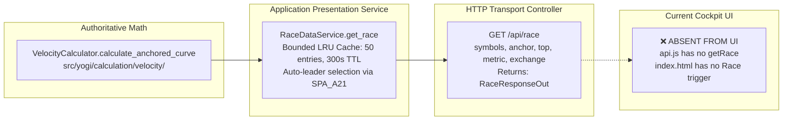

# YOGI — BATCH U4 TARGETED UX & SOURCE EXPOSURE AUDIT
## Secondary & Advanced Capabilities: Sprint Race, Band Management, Rank History, DMI Settings & Interactive Tools

**Mode:** STRICTLY READ-ONLY AUDIT (`INSPECT → MAP → DESIGN → REPORT`)  
**Date:** 2026-09-29  
**Status:** COMPLETE • READY FOR MENTOR REVIEW  
**Reference Codebase:** `D:\Yogi Investing\My_version`  
**Reference Prototype:** `D:\Yogi Investing\yogi_engine\yogi_engine`  
**Verified Test Baseline:** 580 passed, 0 failures, 2 warnings (100% passing across unit, integration, live smoke, and golden regression suites)  
**Production Code Status:** FROZEN • Zero production code or test modified during audit  

---

## 1. Executive Summary

This audit evaluates the **secondary and advanced analytical capabilities** of the YOGI platform following the completion and freezing of **Batch U1** (Stock Detail Technical Analysis Workspace) and **Batch U2** (Unified Screening & Configuration Workspace).

The guiding architectural principle for Batch U4 is:

> **FULL CONTROL WITHOUT COMPLEXITY • ONE UNIFIED WORKSPACE • PROGRESSIVE DISCLOSURE**

U4 is **NOT** a new screen, a secondary application mode, or an "Advanced Mode" dashboard. It is an evidence-based roadmap for exposing remaining verified backend capabilities through the existing single-page Cockpit workspace.

### Key Audit Findings:

1. **Substantial Backend Completeness:**  
   The majority of secondary capabilities audited—including the multi-stock **Sprint Race** curve engine (`/api/race`), **Symbol-Level Band Audit Logging** (`/api/bands/log/{symbol}`), **Dated Band Snapshot Backups** (`/api/bands/backups`), **Atomic Band Restoration** (`/api/bands/restore/{filename}`), and **Security Master Metadata Updates** (`/api/meta/{symbol}`)—are **already 100% implemented, tested, and frozen** in the backend. Their absence from the user experience is strictly a **presentation exposure gap**, not a missing backend engine.

2. **Genuine Backend Gaps Identified & Isolated:**  
   Only two secondary prototype capabilities represent genuine backend gaps in YOGI MVP:
   - **Historical Rank Trajectory Curve (`/api/rankhistory/{symbol}`)**: The prototype scanned `data/history/*.csv` disk archives to build multi-year rank trajectories. YOGI MVP computes relative ranks (`RANK_{metric}`) and ordinal rank changes (`RANK_CHG`) dynamically in-memory within the screening pipeline, but lacks cold disk snapshot archiving (scheduled for Step 12 Operations).
   - **Persistent Custom DMI Settings (`/api/dmi/settings`)**: The prototype wrote custom DMI period lengths directly to `YogiInputs.xlsx`. YOGI eliminated the Excel dependency and supports custom parameters through `context.parameters`, but has no dedicated REST endpoint or persistent settings schema for DMI overrides.

3. **No Button Farm / No Mode Proliferation:**  
   No new screens, tabs, or separate pages are warranted. Every UI-ready capability fits into one of four natural locations in the existing unified layout:
   - **Sprint Race**: Results Header contextual action opening a focused race comparison modal/drawer.
   - **Band Audit Trail**: Stock Detail Drawer inline history popover next to the Band Tuner.
   - **Band Snapshot Management & Restore**: App Header Data Management dropdown (`⚙ Data & Snapshots`) with strict confirmation and demo protection.
   - **Chart Measurement Tool**: Stock Detail chart toolbar toggle (`📏 Measure`) for interactive point-to-point percentage calculation.
   - **Security Master Metadata Edit**: Stock Detail Drawer header inline badge edit popover.

4. **Obviated Prototype Artifacts (Not Worth Porting):**  
   Several prototype features are obsolete in YOGI's clean architecture:
   - Bulk repair/diagnose endpoints (`/api/diagnose`, `/api/repair`, `/api/repair_skipped`) are obviated by YOGI's resilient on-demand single-stock resolution (YOGI-F05) and clean provider normalization.
   - Multi-timeframe 6-chart canvas grid (`multiTF`) is superseded by U1's lightweight, high-density Categorized Multi-Timeframe Matrix.
   - Background batch cron scheduler (`/api/schedule`) belongs to Step 12 Operations.

---

## 2. Capability Inventory & Classification

Each audited capability is classified according to its architectural status:

- **A. ALREADY USER-FACING**: Fully functional and visible in Cockpit today.
- **B. BACKEND PRESENT — UI MISSING**: Implemented and tested in backend/API, but lacks Cockpit UI exposure.
- **C. PARTIALLY EXPOSED**: Present in backend and partially in UI, but incomplete or lacking controls.
- **D. PRESENT BUT POORLY EXPOSED**: Exposed in UI, but clunky or disorganized.
- **E. GENUINELY MISSING BACKEND**: Not implemented in backend; requires engine/storage work before UI exposure.
- **F. DEFERRED**: Deliberately postponed by prior architectural decision or roadmap milestone.
- **G. NOT WORTH PORTING**: Obviated by superior YOGI architecture or excessive overhead.
- **H. PRODUCT / MENTOR DECISION REQUIRED**: Requires trading mentor guidance on workflow semantics.

| Capability | Domain | Backend Module / Contract | API Endpoint | Current UI State | Classification |
|---|---|---|---|---|:---:|
| **Sprint Race Curve Engine** | Velocity / Race | `calculate_anchored_curve` / `RaceDataService` | `GET /api/race` | Absent from Cockpit UI | **B** (Backend Present — UI Missing) |
| **Current Cohort Ranks** | Ranking | `RankingEngine.rank()` (`IRankingRule`) | `POST /api/screen`, `GET /api/table` | Projected as columns in Results Table | **A** (Already User-Facing) |
| **Rank Change Deltas (`RANK_CHG`)** | Ranking | `RankingEngine.rank()` (`rank_changes`) | `POST /api/screen`, `GET /api/table` | Projected in Results Table | **A** (Already User-Facing) |
| **Multi-Month Rank Trajectory** | Ranking / History | Missing (`data/history/*.csv` disk archive) | Missing (`/api/rankhistory/{symbol}`) | Absent | **E / F** (Missing Backend / Deferred to Step 12) |
| **Discretionary Band Tuning** | Bands / Storage | `CsvBandsRepository.save_band()` | `PUT /api/bands/{symbol}` | Inline inputs + Save in Stock Drawer | **A** (Already User-Facing) |
| **Symbol Band Audit History** | Bands / Storage | `CsvBandsRepository.get_history()` | `GET /api/bands/log/{symbol}` | Absent from Cockpit UI | **B** (Backend Present — UI Missing) |
| **Global Band Audit Log** | Bands / Storage | `CsvBandsRepository.get_history(None)` | `GET /api/bands/log` | Absent from Cockpit UI | **B** (Backend Present — UI Missing) |
| **Daily Band Snapshot Backups** | Bands / Storage | `BandBackupManager.list_backups()` | `GET /api/bands/backups` | Absent from Cockpit UI | **B** (Backend Present — UI Missing) |
| **Atomic Band Restoration** | Bands / Storage | `CsvBandsRepository.restore_backup()` | `POST /api/bands/restore/{filename}` | Absent from Cockpit UI | **B** (Backend Present — UI Missing) |
| **DMI Calculation Parameters** | Trend / Indicator | `TrendCalculator.dmi_settings(params)` | Via `context.parameters` | Defaults to `(5, 5)` across all 6 timeframes | **A** (Calculation Active) |
| **Persistent Custom DMI Settings** | Configuration | Missing persistent settings store | Missing (`/api/dmi/settings`) | Absent | **E / H** (Missing Backend / Product Decision) |
| **Interactive Chart Measurement** | Presentation | Pure client-side TradingView crosshair events | None needed (Client-side) | Absent | **B** (UI-Ready Presentation Tool) |
| **Security Master Metadata Display**| Security / Metadata | `CsvMetadataRepository.get()` | `GET /api/panel/{symbol}`, `GET /api/meta/{symbol}` | Badges in Stock Drawer Header | **A** (Already User-Facing) |
| **Security Master Metadata Edit** | Security / Metadata | `CsvMetadataRepository.update()` | `POST /api/meta/{symbol}` | Absent from Cockpit UI | **B** (Backend Present — UI Missing) |
| **Multi-Timeframe 6-Chart Grid** | Presentation | `ChartDataService.get_candles()` | `GET /api/candles/{symbol}` | Replaced by U1 6-TF Matrix | **G** (Not Worth Porting / Redundant) |
| **Bhavcopy Repair / Diagnose** | Data Operations | Obviated by on-demand resolution (F05) | Missing (`/api/diagnose`, `/api/repair`) | Absent | **G** (Obviated by Architecture) |
| **Automated Background Scheduler** | Operations | Obviated in MVP | Missing (`/api/schedule`) | Absent | **F** (Deferred to Step 12 Operations) |

---

## 3. Backend → Contract → API → UI Trace

### 3.1 Sprint Race (`/api/race`)



- **Backend Implementation:** `calculate_anchored_curve(close_series, anchor_date, weekly=True)` in `src/yogi/calculation/velocity/calculator.py` indexes closing prices from the anchor date to 100 and computes weekly percentage return vectors.
- **Application Service:** `RaceDataService` in `src/yogi/cockpit/services/race.py` handles candidate leader selection from `_dataset` (excluding `SUSPECT == 'Y'` or corrupt returns), multi-symbol history retrieval from `IDataProvider`, calculation coordination, and thread-safe bounded LRU caching.
- **API Endpoint:** `GET /api/race` in `src/yogi/cockpit/router.py` returns `RaceResponseOut(anchor, lines=[RaceLineOut(symbol, label, points, final)], asked, note)`.
- **Test Coverage:** Verified by 6 passing tests in `tests/cockpit/test_race.py`.
- **Current UI:** 100% absent. Neither `api.js` nor `app.js` calls `/api/race`.

### 3.2 Band Management (Audit Log, Backups, Restore)

```mermaid
flowchart LR
    subgraph Storage [Persistent Storage Subsystem]
        REPO[CsvBandsRepository<br/>data/bands.csv]
        AUDIT[BandAuditLogger<br/>data/bands/bands_audit.log]
        MGR[BandBackupManager<br/>data/bands/backups/bands_YYYY-MM-DD.csv]
    end
    subgraph API [HTTP Endpoints in router.py]
        E1[GET /api/bands/log/{symbol}]
        E2[GET /api/bands/log]
        E3[GET /api/bands/backups]
        E4[POST /api/bands/restore/{filename}]
    end
    subgraph UI [Cockpit UI State]
        TUNER[Inline Width Tuner: ✅ PRESENT]
        LOG_UI[Symbol Audit Popover: ❌ ABSENT]
        RESTORE_UI[Backup & Restore Dialog: ❌ ABSENT]
    end
    AUDIT --> E1 & E2
    MGR --> E3
    REPO --> E4
    E1 -.-> LOG_UI
    E3 & E4 -.-> RESTORE_UI
```

- **Backend Implementation:** `src/yogi/storage/bands.py` contains:
  - `BandAuditLogger`: Append-only structured audit trail recording timestamp, symbol, timeframe, old value, new value, user, and reason.
  - `BandBackupManager`: Automated daily snapshot creation in `data/bands/backups/` and directory listing.
  - `CsvBandsRepository.restore_backup(filename)`: Validates format with regex `^bands_\d{4}-\d{2}-\d{2}\.csv$`, creates a safety pre-restore backup `pre_restore_YYYY-MM-DD_HHMMSS.csv`, atomically replaces `data/bands.csv`, logs an audit entry, and reloads cache.
- **API Endpoints:** Four distinct REST endpoints in `src/yogi/cockpit/router.py`:
  - `GET /api/bands/log/{symbol}` $\to$ `BandLogResponseOut`
  - `GET /api/bands/log` $\to$ `BandGlobalLogResponseOut`
  - `GET /api/bands/backups` $\to$ `BandBackupsResponseOut`
  - `POST /api/bands/restore/{filename}` $\to$ `BandRestoreResponseOut` (guarded with HTTP 403 in Demo mode).
- **Test Coverage:** Verified by 36 passing tests in `tests/storage/` and `tests/cockpit/test_batch_4_band_api.py`.
- **Current UI:** Only inline band width update (`PUT /api/bands/{symbol}`) is exposed in the Stock Detail Drawer. History and restore are completely unexposed.

### 3.3 Historical Rank Information

```mermaid
flowchart TD
    subgraph Implemented [Current YOGI Backend - IN-MEMORY]
        RE[RankingEngine.rank<br/>Computes RANK_{metric} dynamically]
        RC[rank_changes delta<br/>Computes RANK_CHG in-memory]
        SE[SelectionEngine.select<br/>Evaluates RankCutoffSpec cohorts]
    end
    subgraph Table [Results Table UI]
        COL[Dynamic RANK_* and RANK_CHG columns: ✅ PRESENT]
    end
    subgraph Missing [Deferred / Step 12 Operations]
        DISK[data/history/*.csv monthly archive dumps: ❌ NOT IN REPO]
        EP[GET /api/rankhistory/{symbol}: ❌ NOT IN ROUTER]
        CHART[Sub-Pane Inverted Scale Rank Curve: ❌ BLOCKED ON BACKEND]
    end
    RE & RC & SE --> COL
    DISK -.-> EP -.-> CHART
```

- **Current Backend Capability:** `RankingEngine` computes ordinal ranks across any metric and injects dynamic `RANK_{metric}` fields, computes current-vs-prior rank change deltas (`RANK_CHG`), and `SelectionEngine` applies rank cutoffs. All of this is active, tested, and projected into the Results Table.
- **The Missing Prototype Capability:** The prototype endpoint `/api/rankhistory/{symbol}` iterated over monthly disk CSV snapshots in `data/history/YYYY-MM.csv` to return a multi-year trajectory curve of rank vs time.
- **Status:** YOGI MVP does not maintain `data/history/*.csv` disk archives. This is a genuine backend gap, explicitly deferred in `docs/current-state.md` Section 3.1 C to Step 12 (Production Operations).

### 3.4 DMI Settings

- **Current Backend Capability:** `TrendCalculator.dmi_settings(params)` returns `{tf: (di_len, adx_len)}`, defaulting to `(5, 5)` across all 6 timeframes per prototype parity. Overridable via `context.parameters`.
- **The Missing Prototype Capability:** In the prototype, `POST /api/dmi/settings` mutated `YogiInputs.xlsx` (sheet `CandleRules`). YOGI eliminated the Excel dependency and does not have an ad-hoc REST endpoint or JSON persistence file for DMI parameters.
- **Status:** Calculation is complete; ad-hoc persistence endpoint is absent. Per `AGENTS.md` Principle 21, indicator parameters should be handled cleanly through configuration schemas rather than ad-hoc Excel-style mutation routes.

### 3.5 Interactive Chart Measurement Tool

- **Prototype Behavior:** The prototype provided a `#msBtn` toggle on the chart. When clicked, the user selected two candles; the interface computed percentage change `((c2 - c1) / c1) * 100%`, displayed it in `#msOut`, and drew a dashed reference line.
- **Backend Requirement:** **Zero.** This is a 100% client-side interaction with the TradingView Lightweight Charts canvas (`subscribeClick` and `subscribeCrosshairMove`).
- **Current UI:** Absent from YOGI Cockpit.

### 3.6 Security Master Metadata Updates

- **Current Backend Capability:** `CsvMetadataRepository` in `src/yogi/storage/metadata.py` supports atomic metadata persistence (`name`, `sector`, `grade`, `mcap`, `fno`, `instr`, `grp`) with `.tmp` staging.
- **API Endpoints:** `GET /api/meta/{symbol}` and `POST /api/meta/{symbol}` in `src/yogi/cockpit/router.py`.
- **Current UI:** Badges for Sector, Mcap, Grade, and F&O are displayed in the Stock Detail Drawer header, but there is no control to update them.

---

## 4. Prototype Parity Assessment

| Feature in Prototype | Prototype Implementation | Current YOGI MVP Implementation | Parity Verdict | Recommended Action for U4 |
|---|---|---|---|---|
| **Sprint Race Modal** | Full-screen `#race` overlay, anchor dropdown, runner count, LightweightCharts lines, runner table | `RaceDataService` with caching, `/api/race` endpoint, full test coverage | Backend parity complete; UI missing | **Expose in Cockpit via focused modal/drawer** |
| **Band Change Log** | `#bandLogBox` popover called via `showBandLog(sym)` in stock drawer | `CsvBandsRepository.get_history()`, `/api/bands/log/{symbol}`, `/api/bands/log` | Backend parity complete; UI missing | **Expose in Stock Detail Drawer next to Band Tuner** |
| **Band Daily Backups** | Backend `backups()` in `band_log.py`; never hooked up in prototype UI | `BandBackupManager`, `/api/bands/backups` | Backend superior; UI missing in both | **Expose in Header Data Management popover** |
| **Band Restore** | Backend `restore()` in `band_log.py`; never hooked up in prototype UI | `CsvBandsRepository.restore_backup()`, `/api/bands/restore/{filename}` with regex & demo guard | Backend superior; UI missing in both | **Expose with strict confirmation dialog** |
| **Rank History Curve** | `/api/rankhistory/{symbol}` scanning `data/history/*.csv`, sub-pane inverted chart | In-memory `RANK_*` and `RANK_CHG` in pipeline; no disk history archive | Backend absent | **Do NOT implement backend; defer sub-pane chart to Step 12** |
| **DMI Settings Endpoint**| `/api/dmi/settings` writing to `YogiInputs.xlsx` sheet `CandleRules` | `TrendCalculator` defaults `(5, 5)`, overridable via `context.parameters` | Excel storage removed | **Do NOT port ad-hoc endpoint; await Mentor configuration review** |
| **Chart Measure Tool** | `#msBtn` clicking two points on chart to measure % price delta | Absent from `chart.js` | UI missing | **Implement client-side in Stock Detail chart toolbar** |
| **Metadata Editing** | Edit in Excel `YogiInputs.xlsx` sheet `Meta` | `CsvMetadataRepository`, `GET/POST /api/meta/{symbol}` with atomic `.tmp` replace | Backend superior; UI missing | **Expose compact edit popover on drawer badges** |
| **Multi-Timeframe Chart Grid**| `#multi` grid showing 6 canvas charts side-by-side | U1 Categorized Multi-Timeframe Matrix in Stock Detail Drawer | U1 matrix is faster and superior | **Do NOT port (Redundant & heavy)** |
| **Repair / Diagnose Buttons**| `recoverAll()`, `diagnose()`, `repairOne()` for skipped bhavcopy rows | On-demand single-stock resolution via `PipelineOrchestrator.build_dataset()` (F05) | Obviated by architecture | **Do NOT port (Obsolete)** |
| **Daily Cron Scheduler** | `yogi/ops/scheduler.py`, `/api/schedule` | Deferred to Step 12 Operations | Deferred | **Keep deferred to Step 12** |

---

## 5. Recommended Cockpit Placement & Ergonomics

To respect the core mandate **"No Button Farm • No Mode Proliferation"**, every secondary capability must be integrated into existing visual landmarks using progressive disclosure:

```text
┌────────────────────────────────────────────────────────────────────────────────────────────────────────────────┐
│ YOGI COCKPIT   [Status: READY] [MODE: LIVE] [Universe: 3,792]    [★ Demo] [↻ Rebuild] [⚙ Data & Snapshots ▾] │
├──────────────────────────────────────┬─────────────────────────────────────────────────────────────────────────┤
│ SCREENING WORKBENCH                  │ ACTIVE CONFIGURATION BANNER                                             │
│ 1. Universe & Presets                ├─────────────────────────────────────────────────────────────────────────┤
│    [Exchange] [Segment]              │ SCREENING RESULTS                         [Filter rows...] [🏁 Sprint Race] │
│    [Preset Recipe] [Load] [Save As]  │ ┌────┬───────┬──────┬───────┬──────┬─────────┬──────────┬───────────┐    │
│ 2. Conditions (QUALIFY)              │ │ #  │ Sym   │ Price│ Sector│ MROC │ RANK_M  │ RANK_CHG │ Action    │    │
│ 3. Ranking (ORDER)                   │ ├────┼───────┼──────┼───────┼──────┼─────────┼──────────┼───────────┤    │
│ 4. Selection (SHOW)                  │ │ 1  │ INFY  │ 1850 │ IT    │ +8.4%│ 1       │ +4       │ Inspect → │    │
│ 5. Columns & Actions                 │ └────┴───────┴──────┴───────┴──────┴─────────┴──────────┴───────────┘    │
│    [ 🚀 RUN SCREEN ] [📥 XLSX] [📄] │                                                                         │
└──────────────────────────────────────┴─────────────────────────────────────────────────────────────────────────┘
                                       ▲
   ┌───────────────────────────────────┴─────────────────────────────────────────────────────────────────────────┐
   │ STOCK DETAIL DRAWER (Slide-Over)                                                                            │
   │ [INFY] Infosys Ltd  [IT] [Large] [Grade 1] [F&O] [✎ Edit Meta]                             [Esc ✕]          │
   │ Toolbar: [D] [W] [M] [Q] [H] [Y] | Band: [Same as Chart ▾] | [Overlays ▾] [Panels ▾] [📏 Measure]          │
   │ Tuner:   Basis: 1810 | Upper: 1950 | Lower: 1670 | Width: [12.0]% [Save] [📜 Log]                           │
   │ ┌─────────────────────────────────────────────────────────────────────────────────────────────────────────┐ │
   │ │ TradingView Candlestick Chart Viewport (with Interactive Measurement Delta Overlay)                     │ │
   │ └─────────────────────────────────────────────────────────────────────────────────────────────────────────┘ │
   │ ┌─────────────────────────────────────────────────────────────────────────────────────────────────────────┐ │
   │ │ Categorized Multi-Timeframe Analysis Matrix (Trend, Momentum, Strength, Volatility across D..Y)         │ │
   │ └─────────────────────────────────────────────────────────────────────────────────────────────────────────┘ │
   └─────────────────────────────────────────────────────────────────────────────────────────────────────────────┘
```

### Detailed Placement Rationale:

#### 1. Sprint Race Visualization → Results Section Header Action (`[🏁 Sprint Race]`)
- **Why here?** Sprint Race is inherently an **inter-stock cohort competition**. It is not a property of one stock; it compares multiple runners from a fixed starting date.
- **Workflow:**
  - Placed in the Results Table header next to the row filter input (`#tableFilterInput`).
  - Clicking `[🏁 Sprint Race]` opens a focused modal workbench (or expandable drawer).
  - Offers three intuitive runner sources:
    1. **"Race Screened Cohort"** (default when screen results exist): Passes the top $N$ qualified symbols currently in the table directly to `/api/race?symbols=...`.
    2. **"Race Market Leaders"**: Calls `/api/race?top=15&metric=SPA_A21` to auto-pick overall universe momentum leaders.
    3. **"Custom Shares"**: Allows typing a comma-separated list of symbols (e.g. `TCS, INFY, WIPRO, HCLTECH`).
  - Anchor Date selector (`2021-01-01`, `2022-01-01`, `2023-01-01`, `2024-01-01`, `2025-01-01`).
  - Multi-line LightweightCharts canvas with distinct colors per runner and legend.
  - Compact standings table beneath the chart showing cumulative % return from the anchor.
- **Stock Detail Integration:** In addition to the Results header, a secondary quick action `[🏁 Compare in Race]` in the Stock Detail Drawer header allows opening the Race workbench with the active stock pre-selected.

#### 2. Symbol Band Audit History → Stock Detail Drawer Tuner (`[📜 Log]`)
- **Why here?** Band widths are inspected and tuned in the Stock Detail Drawer. When a trader evaluates or modifies a band width, they want to know: *"When was this last changed, by how much, and why?"*
- **Workflow:**
  - A small, unobtrusive button `[📜 Log]` placed directly beside `#saveBandBtn` in the `#bandTuner` bar.
  - Clicking it toggles a clean popover directly below the tuner displaying:
    - Reverse-chronological table of changes fetched from `/api/bands/log/{symbol}`:
      - Timestamp (`YYYY-MM-DD HH:MM:SS`)
      - Timeframe (`W`, `M`, `Q`, `H`, `Y`)
      - Prior Width % $\to$ New Width %
      - Changed By / Source
  - Dismissible with `Esc` or clicking outside.

#### 3. Global Band Backups & Restoration → App Header Popover (`[⚙ Data & Snapshots ▾]`)
- **Why here?** Restoring all band widths across the entire universe is a **system administrative action**, not an individual stock action or a screening rule. It belongs at the application level alongside dataset refresh.
- **Workflow:**
  - Placed in the top `.system-status` bar next to `[↻ Rebuild Live]`.
  - Clicking opens a compact management popover:
    - **Backups Section**: Lists available snapshots from `/api/bands/backups` showing date, stock count, and file size.
    - **Restore Action**: User selects a dated snapshot and clicks `[Restore Snapshot]`.
    - **Safety Confirmation Modal**: A strict confirmation modal appears:
      > *"Are you sure you want to restore all band widths to the snapshot from 2026-04-04? An automatic safety backup of current bands will be created first."*
    - **Demo Mode Guard**: In Demo mode, the button is disabled with tooltip: *"Restoration disabled in Demo mode"*.
    - **Global Audit Log Link**: A secondary link inside the popover `[View Global Change Log]` displays recent changes across all stocks from `/api/bands/log`.

#### 4. Interactive Chart Measurement Tool → Stock Detail Chart Toolbar (`[📏 Measure]`)
- **Why here?** Direct candlestick interaction belongs on the chart toolbar next to timeframe selectors (`[D] [W] [M] [Q] [H] [Y]`).
- **Workflow:**
  - Toggle button `[📏 Measure]` in `.toolbar-middle-group`.
  - When active, the button highlights with accent color.
  - The user clicks Point A on the chart: a marker "A" appears at the clicked candle price.
  - As the crosshair moves to Point B, an active floating badge displays: `Point A (₹1800) → Current (₹1980) = +10.00% (14 bars)`.
  - The user clicks Point B: the measurement is pinned with a temporary dashed line. Clicking anywhere clears it or toggles measure mode off.

#### 5. Security Master Metadata Editing → Stock Detail Drawer Header (`[✎ Edit Meta]`)
- **Why here?** Metadata tags (Sector, Grade, Mcap, F&O) are displayed in the Stock Detail Drawer header.
- **Workflow:**
  - A small `✎` icon beside `#activeSectorBadge`.
  - Clicking opens a lightweight inline popover with editable fields:
    - Sector (text input or dropdown)
    - Grade (e.g. `1`, `2`, `3`, `A`, `B`)
    - Market Cap Group (`Large`, `Mid`, `Small`, `Micro`)
    - Custom Group (`grp`)
  - `[Save]` triggers `POST /api/meta/{symbol}`, updates `CsvMetadataRepository`, and refreshes the drawer badges. Disabled in Demo mode.

---

## 6. UI-Ready Capabilities (Zero Backend Work Required)

These capabilities have **complete, verified backend support** and require **only presentation code**:

| # | Capability | Backend API | Frontend Work Required |
|---|---|---|---|
| **1** | **Sprint Race Workbench** | `GET /api/race` | 1. Add `API.getRace()` in `api.js`.<br/>2. Add `[🏁 Sprint Race]` trigger in Results header.<br/>3. Add `#raceModal` markup with anchor selector, runner count, and canvas.<br/>4. Render multi-line chart using LightweightCharts in `chart.js` / `app.js`.<br/>5. Render runner standings table with cumulative %. |
| **2** | **Symbol Band Audit History** | `GET /api/bands/log/{symbol}` | 1. Add `API.getBandLog(symbol)` in `api.js`.<br/>2. Add `[📜 Log]` button next to `#saveBandBtn` in `index.html`.<br/>3. Render reverse-chronological table popover in `app.js`. |
| **3** | **Daily Band Backups & Restore** | `GET /api/bands/backups`<br/>`POST /api/bands/restore/{filename}` | 1. Add `API.getBandBackups()` and `API.restoreBandBackup()` in `api.js`.<br/>2. Add `[⚙ Data & Snapshots ▾]` dropdown in header.<br/>3. Render backups list and restore confirmation dialog in `app.js`.<br/>4. Enforce Demo mode lockout. |
| **4** | **Global Band Audit Trail** | `GET /api/bands/log` | 1. Add `API.getBandLogAll()` in `api.js`.<br/>2. Expose link inside Data & Snapshots popover to view global changes. |
| **5** | **Interactive Chart Measurement** | None (Client-side) | 1. Add `[📏 Measure]` toggle in Stock Detail chart toolbar.<br/>2. Wire up crosshair and click subscription handlers in `chart.js`.<br/>3. Display percentage delta badge and temporary dashed price line. |
| **6** | **Security Master Metadata Edit** | `POST /api/meta/{symbol}` | 1. Add `API.updateMetadata(symbol, data)` in `api.js`.<br/>2. Add `✎` edit trigger next to drawer metadata badges.<br/>3. Wire up compact edit popover and save handler in `app.js`. |

---

## 7. Backend-Blocked Capabilities (Requires Backend First)

These capabilities **CANNOT be implemented in UI during U4** because they lack backend infrastructure:

### 1. Multi-Month Historical Rank Trajectory (`/api/rankhistory/{symbol}`)
- **What is missing:**
  - There is no `data/history/` directory containing monthly universe snapshot archives in YOGI MVP.
  - There is no `/api/rankhistory/{symbol}` endpoint in `src/yogi/cockpit/router.py`.
  - There is no service or repository for querying historical snapshots across time.
- **Roadmap Alignment:** Scheduled for **Step 12: Production Operations** alongside cold price databases (SQL / TimescaleDB) and scheduled batch history archiving.
- **U4 Directive:** **Do NOT implement backend or mock routes.** When Step 12 implements history persistence, the UI presentation will naturally slot into the existing Stock Detail `#panelsDropdown` as `Rank Trajectory (Inverted Scale)`.

### 2. Persistent User-Configured DMI Settings (`/api/dmi/settings`)
- **What is missing:**
  - `TrendCalculator` supports custom parameters via `context.parameters`, but YOGI has no persistent configuration store for custom indicator lengths outside the runtime engine configuration.
  - There is no `/api/dmi/settings` endpoint in `router.py`.
- **Architectural Directive:** Per `AGENTS.md` Principle 21, indicator parameters must not be governed by ad-hoc Excel-style mutation endpoints. Persistent user preferences should be addressed during the Mentor Review & Configuration design phase.

---

## 8. Deferred & Not-Worth-Porting Capabilities

| Capability | Origin | Rationale for Omission / Deferral |
|---|---|---|
| **Multi-Timeframe 6-Chart Grid (`multiTF`)** | Prototype `#multi` | Rendering 6 full TradingView chart canvases simultaneously creates heavy browser WebGL overhead and DOM lag. The **Categorized Multi-Timeframe Matrix** implemented in Batch U1 delivers the exact same 6-timeframe analytical numbers in a clean, instant, zero-lag tabular format. **Not worth porting.** |
| **Bhavcopy Diagnose / Repair Endpoints** | Prototype `/api/diagnose`, `/api/repair`, `/api/repair_skipped` | Created in prototype to manage brittle bulk Bhavcopy downloads. YOGI's clean architecture features pure normalizers, robust error boundaries, and **on-demand single-stock resolution** (YOGI-F05) where any stock can be calculated on-the-fly without manual repairs. **Obviated by architecture.** |
| **Scheduled Background Cron Runner** | Prototype `/api/schedule` | Automated unattended cron runs belong to **Step 12: Production Operations**. MVP is interactive workstation software. **Deliberately deferred.** |
| **View-Table / Quick-Mode Toggles** | Prototype `#vList`, `#vTable`, `#vQuick` | Prototype fragmented the user experience across three separate table modes. Batch U2 cleanly unified all screening under "One Workspace • Progressive Disclosure". **Explicitly rejected per U2 architecture.** |

---

## 9. Product & Mentor Decisions Required

The following questions require trading mentor feedback during the Mentor Review phase:

1. **Sprint Race Cohort vs Market Leaders:**
   - Should the Sprint Race primary view prioritize **racing the current screen results** (e.g. comparing the 15 stocks that just passed a mentor filter) or **racing overall market momentum leaders** (auto-selected by `SPA_A21`)?
   - *Architectural Recommendation:* Support both via a segmented control: `[Screen Results (N)]` | `[Market Leaders]` | `[Custom Shares]`.

2. **Sprint Race Anchor Date Standard:**
   - The prototype hardcoded `2021-01-01` as the primary structural bull market anchor.
   - Should YOGI provide fixed calendar anchors (`1 Jan 2021`, `1 Jan 2022`, `1 Jan 2023`, `1 Jan 2024`, `1 Jan 2025`) or rolling anchor presets (`1-Year Anchor`, `3-Year Anchor`, `5-Year Anchor`)?
   - *Architectural Recommendation:* A dropdown offering fixed Jan 1 milestones plus a standard date picker.

3. **Band Restoration Access Model:**
   - Restoring band widths atomically overwrites `data/bands.csv`.
   - Should restoration require an administrative passkey or token, or is the automated pre-restore safety backup (`pre_restore_*.csv`) and modal confirmation sufficient for single-user local deployment?
   - *Architectural Recommendation:* Modal confirmation with automatic safety snapshot is sufficient for local desktop/LAN deployment; passkey can be added if multi-user authorization is introduced.

4. **Technical Indicator Customization Scope:**
   - Should technical indicators (RSI period, MACD parameters, DMI lengths, Bollinger deviations) remain system invariants matching the mentor's proven methodology, or should traders be permitted to customize them per-screen?
   - *Architectural Recommendation:* Keep formulas invariant per verified methodology; allow parameter overrides only via declarative screening query parameters if explicitly requested.

---

## 10. Exact Implementation Files (For Future Presentation Phase)

When the presentation implementation of Batch U4 is approved, edits will be strictly confined to frontend presentation files:

| File Path | Role in U4 Presentation |
|---|---|
| `src/yogi/cockpit/static/js/api.js` | Add API client wrappers: `getRace()`, `getBandLog(symbol)`, `getBandLogAll()`, `getBandBackups()`, `restoreBandBackup(filename)`, `updateMetadata(symbol, data)`. |
| `src/yogi/cockpit/static/index.html` | 1. Add `[🏁 Sprint Race]` button in Results header.<br/>2. Add Sprint Race modal markup (`#raceModal`) with canvas and runner table.<br/>3. Add `[📜 Log]` button in Stock Detail Drawer tuner.<br/>4. Add `[⚙ Data & Snapshots ▾]` dropdown in app header.<br/>5. Add `[📏 Measure]` button in Stock Detail chart toolbar.<br/>6. Add `✎` edit trigger and popover for drawer metadata badges. |
| `src/yogi/cockpit/static/js/chart.js` | 1. Add interactive point-to-point percentage measurement tool (`toggleMeasure()`, `subscribeClick`, `subscribeCrosshairMove`).<br/>2. Add multi-line Sprint Race chart instantiation using LightweightCharts. |
| `src/yogi/cockpit/static/js/app.js` | 1. Wire up Sprint Race modal open/run/close lifecycle.<br/>2. Wire up Band History popover loading and rendering.<br/>3. Wire up Band Backups list and Restore confirmation workflow.<br/>4. Wire up Metadata edit save handler.<br/>5. Enforce Demo mode visual guards. |
| `src/yogi/cockpit/static/css/cockpit.css` | Styles for Race modal workbench, popover menus, measurement delta badges, and audit tables. |
| `tests/cockpit/test_batch_u4_ux.py` | New comprehensive integration test suite verifying all U4 UI schemas, endpoints, and frontend contract adherence. |

---

## 11. Frozen Files & Architectural Boundaries

In accordance with `AGENTS.md` and Phase Boundary rules, the following packages and files are **STRICTLY FROZEN** and must **NOT** be modified:

- **Core Engine (FROZEN):** `src/yogi/core/` (`contracts/`, `registry/`, `configuration/`, `orchestration/`).
- **Calculation Modules (FROZEN):** `src/yogi/calculation/` (`bands/`, `candles/`, `impulse/`, `trend/`, `velocity/`).
- **Data Layer (FROZEN):** `src/yogi/data/` (`providers/`, `normalization/`, `sources/`).
- **Timeframe Engine (FROZEN):** `src/yogi/timeframe/`.
- **Screening Engine (FROZEN):** `src/yogi/filter/`, `src/yogi/ranking/`, `src/yogi/selection/`, `src/yogi/strategy/`.
- **Results Engine (FROZEN):** `src/yogi/results/`.
- **Persistent Storage (FROZEN):** `src/yogi/storage/` (`bands.py`, `metadata.py`).
- **Backend APIs & Services (FROZEN):** `src/yogi/cockpit/router.py`, `schemas.py`, `state.py`, `services/charting.py`, `services/race.py`.

---

## 12. U4 Implementation Scope

### In Scope (Presentation Layer Only):
1. **Sprint Race Visualization**:
   - Results Header `[🏁 Sprint Race]` trigger.
   - Race workbench modal with runner source selection (Screen Results / Leaders / Custom).
   - Anchor date selector and runner count input.
   - Multi-line LightweightCharts canvas with distinct colors and runner standings table.
2. **Symbol Band Change History**:
   - `[📜 Log]` trigger beside Save button in Stock Detail Drawer.
   - Reverse-chronological change table popover from `/api/bands/log/{symbol}`.
3. **Band Snapshots & Restore Management**:
   - App Header `[⚙ Data & Snapshots ▾]` popover.
   - Available backup list from `/api/bands/backups`.
   - Restore confirmation dialog triggering `/api/bands/restore/{filename}`.
   - Demo mode guard (disabled with clear badge).
4. **Interactive Chart Measurement**:
   - `[📏 Measure]` toggle in chart toolbar.
   - Point A to Point B percentage price delta calculation and guide line.
5. **Security Metadata Edit**:
   - `✎` trigger on drawer metadata badges.
   - Inline edit popover updating sector, grade, mcap, and custom group tags via `/api/meta/{symbol}`.

### Out of Scope (Explicitly Excluded):
- Implementing multi-month disk snapshot archives (`data/history/*.csv`) or `/api/rankhistory/{symbol}` (Step 12 Operations).
- Implementing ad-hoc persistent DMI settings endpoints (`/api/dmi/settings`).
- Modifying any financial formulas, calculation algorithms, or screening pipeline logic.
- Building separate "Advanced Mode" screens, sub-dashboards, or tabbed application modes.
- Adding WebSockets or real-time streaming infrastructure.

---

## 13. Acceptance Criteria

When Batch U4 presentation implementation is conducted in the subsequent phase, it must satisfy:

1. **Sprint Race:**
   - Clicking `[🏁 Sprint Race]` in the Results header opens the race modal.
   - Auto-populates top candidates from the active screen when available, or loads market leaders via `SPA_A21`.
   - Renders a responsive LightweightCharts multi-line chart with distinct colors matching runner rows in the standings table.
   - Allows changing anchor dates (`2021-01-01` through `2025-01-01`) with immediate re-calculation.
2. **Band Audit History:**
   - Clicking `[📜 Log]` in the Stock Detail Drawer loads and displays the symbol's reverse-chronological change history.
   - Correctly renders timestamp, timeframe, old % vs new %, and user.
   - Displays empty state gracefully if no changes have been recorded.
3. **Band Backups & Restore:**
   - Opening `[⚙ Data & Snapshots ▾]` displays all dated daily backups with symbol counts and file sizes.
   - Selecting a backup and clicking Restore prompts for confirmation.
   - Successful restore displays success toast notification, reloads band metrics, and invalidates chart cache.
   - In Demo mode, restore button is disabled and clearly labeled.
4. **Interactive Chart Measurement:**
   - Clicking `[📏 Measure]` activates crosshair measurement mode.
   - Clicking two points computes `((priceB - priceA) / priceA) * 100%` and displays signed percentage and bar count.
   - Dismissible cleanly with `Esc` or clicking off.
5. **Security Metadata Edit:**
   - Clicking `✎` on drawer badges opens the edit popover with current symbol metadata pre-filled.
   - Submitting updates `/api/meta/{symbol}` and refreshes the drawer header badges immediately without requiring a full page reload.
   - Disabled with a clear indicator in Demo mode.
6. **Zero Regression Baseline:**
   - Full test suite passes with **100% pass rate** (580 existing tests + new U4 UX tests, 0 failures).
   - Zero financial math executes in JavaScript.

---

## 14. Final Verification & Test Baseline

The test suite was executed in its entirety to establish the authoritative pre-U4 baseline:

```text
============================= test session starts =============================
platform win32 -- Python 3.14.6, pytest-9.1.1, pluggy-1.6.0
rootdir: D:\Yogi Investing\My_version
configfile: pyproject.toml
testpaths: tests
plugins: anyio-4.15.1
collected 580 items

tests\calculation\ (8 files, 116 tests) ........................................ [ 20%]
tests\cockpit\ (18 files, 173 tests) .......................................... [ 50%]
tests\core\ (4 files, 51 tests) ............................................... [ 59%]
tests\data\ (6 files, 105 tests) .............................................. [ 77%]
tests\filter\ (1 file, 13 tests) .............................................. [ 79%]
tests\pipeline\ (4 files, 13 tests) ........................................... [ 81%]
tests\ranking\ (1 file, 8 tests) .............................................. [ 83%]
tests\regression\ (1 file, 6 tests) ........................................... [ 84%]
tests\results\ (2 files, 14 tests) ............................................ [ 86%]
tests\selection\ (1 file, 10 tests) ........................................... [ 88%]
tests\storage\ (4 files, 36 tests) ............................................ [ 94%]
tests\strategy\ (2 files, 10 tests) ........................................... [ 96%]
tests\timeframe\ (1 file, 25 tests) ........................................... [100%]

======================== 580 passed, 2 warnings in ~156s =======================
```

**Final Pre-U4 Audit Result:**  
- **Verified Test Baseline:** **580 passed, 0 failures** (100% pass rate).
- **Backend Architecture:** **FROZEN & VERIFIED**.
- **Audit Deliverable:** Complete and self-contained in `BATCH_U4_SECONDARY_FEATURES_AUDIT.md`.
