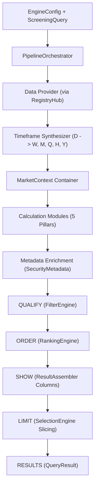

# YOGI Technical Architecture

This document defines the stable architectural structure, subsystem boundaries, contracts, data flow, and dependency principles for the YOGI platform per [`AGENTS.md`](../AGENTS.md).

---

## 1. Architectural Foundations

### Core Architectural Principle
YOGI is engineered around a single fundamental philosophy:

> **Stable Core • Replaceable Modules • Contract-Based Connections**

- **Stable Core**: The center of the system coordinates execution through contracts, registries, configurations, and pipeline orchestration without containing domain-specific implementations.
- **Replaceable Modules**: Every concrete capability (market data providers, analytical calculators, storage repositories) is an isolated module that can be replaced without forcing changes to unrelated modules or the pipeline core.
- **Contract-Based Connections**: Modules communicate exclusively through strongly typed, frozen abstract interfaces. Core depends on contracts, not concrete classes.

### The Mental Model
The platform processes user intent into analytical screening results through a disciplined hierarchy:

```text
UI / User Choices (Cockpit Presentation Facade)
       ↓
Configuration       (What does YOGI want to do? ScreeningConfig, ScreeningQuery)
       ↓
Orchestration       (PipelineOrchestrator: QUALIFY → ORDER → SHOW → LIMIT → RESULTS)
       ↓
Registry            (RegistryHub: Which implementation provides each capability?)
       ↓
Implementations     (Data providers, calculation engines, storage repositories)
       ↓
Results / UI        (Assembled QueryResult payload projected to Cockpit Workbench)
```

---

## 2. Target Repository Structure

```text
src/yogi/
├── core/                         # [FROZEN] Invariant platform center
│   ├── contracts/                # Authoritative interfaces and canonical DTOs (10 modules)
│   ├── registry/                 # Capability mapping and RegistryHub (3 pillars)
│   ├── configuration/            # ScreeningConfig, ScreeningQuery, StrategyCatalog
│   └── orchestration/            # PipelineOrchestrator coordinator
│
├── data/                         # [FROZEN] Market data acquisition & normalization
│   ├── providers/                # External adapters (Demo, Twelve Data, Yahoo, Zerodha)
│   ├── normalization/            # Pure normalizers (bars, classification, F&O universe)
│   └── sources/                  # Resilient external data sources (official NSE downloads)
│
├── storage/                      # [FROZEN] Crash-resilient atomic file persistence
│   ├── bands.py                  # CsvBandsRepository, audit trail, daily backups, restore
│   └── metadata.py               # CsvMetadataRepository (security master metadata)
│
├── timeframe/                    # [FROZEN] Multi-timeframe synthesis (D -> W, M, Q, H, Y)
│
├── calculation/                  # [FROZEN] Five Analytical Mathematical Pillars
│   ├── bands/                    # Volatility envelope, Bollinger, Donchian, ATR, band distance
│   ├── candles/                  # Candlestick recognition theory (204 shapes/patterns)
│   ├── impulse/                  # Zigzag reversal pivots & Ram's 50% recovery validation
│   ├── trend/                    # Trailing ROC, 3/5 EMA, CAGRs, ATH, DMI/ADX, VWAP, RSI, MACD, OBV, MFI
│   └── velocity/                 # Rolling speed (S4..S52), acceleration, sprint consistency, race curves
│
├── filter/                       # [FROZEN] Qualification criteria & boolean composition (QUALIFY)
├── ranking/                      # [FROZEN] Multi-key sorting & dynamic cohort ranking (ORDER)
├── selection/                    # [FROZEN] Top N cutoffs & cohort survival limits (LIMIT)
├── strategy/                     # [FROZEN] Declarative recipes & 21 Verified Mentor Presets
├── results/                      # [FROZEN] Column projection, formatting & Excel exports (SHOW/RESULTS)
├── pipeline/                     # [FROZEN] End-to-end screening orchestrator implementation
└── cockpit/                      # [FROZEN] Presentation workbench, REST API & TradingView charting
    ├── app.py                    # FastAPI application factory
    ├── router.py                 # REST API route handlers
    ├── schemas.py                # Strongly typed Pydantic response models
    ├── app_state.py              # In-memory coordination & bounded LRU caches
    ├── services/                 # ChartDataService (19+ series), RaceVisualizerService
    └── static/                   # HTML5 single-page workbench, JS, CSS
```

---

## 3. Authoritative Contracts (`src/yogi/core/contracts/`)

Every cross-module boundary is governed by an explicit, frozen contract:

| Contract Module | Key Classes / Protocols | Primary Responsibility | Anti-Responsibility (What it must NOT do) | Lifecycle Status |
|---|---|---|---|---|
| **`market_data.py`** | `MarketBar`, `TickData`, `MarketContext`, `IMarketDataProvider`, `ITickDataProvider` | Invariant representation of price, volume, and multi-timeframe bar containers. | Transforming vendor formats or computing indicators. | **FROZEN** |
| **`provider.py`** | `IDataProvider`, `ProviderHealth` | Common protocol for external vendor adapters. | Business logic, filtering, or caching. | **FROZEN** |
| **`timeframe.py`** | `ITimeframeSynthesizer` | Contract for aggregating base bars into higher timeframes. | Ranking, screening, or indicator calculation. | **FROZEN** |
| **`calculation.py`** | `CalculationResult`, `ICalcModule`, `CalculationContext` | Contract for numerical calculation modules. | Network requests, storage I/O, or presentation. | **FROZEN** |
| **`bands.py`** | `IBandsRepository`, `BandEntry`, `BandAuditEntry`, `BandBackupInfo`, `BAND_TIMEFRAMES` | Contract for retrieving and persisting user-defined volatility band levels. | Computing band positions or pricing envelopes. | **FROZEN** |
| **`security.py`** | `SecurityMetadata`, `InstrumentType`, `TradingGroup`, `ISecurityMetadataRepository` | Contract for instrument classification, trading groups, and metadata storage. | External network fetching or price calculation. | **FROZEN** |
| **`filter.py`** | `IFilterRule`, `FilterOperator`, `FilterRuleSpec`, `FilterGroupSpec` | Contract for boolean candidate qualification (`QUALIFY`). | Sorting, relative ranking, or record truncation. | **FROZEN** |
| **`ranking.py`** | `IRankingRule`, `RankingOrder`, `RankingMethod`, `RankingResult` | Contract for relative metric sorting across surviving candidates (`ORDER`). | Filtering candidates or truncating output sets. | **FROZEN** |
| **`selection.py`** | `ISelectionRule`, `SelectionMode`, `RankCutoffSpec`, `SelectionResult` | Contract for applying rank cutoffs and cohort survival limits (`LIMIT`). | Calculating metric ranks or filtering records. | **FROZEN** |
| **`strategy.py`** | `IStrategy`, `StrategySpec`, `StrategyValidationResult` | Contract for declarative screening recipe composition. | Direct calculation or data mutation. | **FROZEN** |
| **`results.py`** | `IResultAssembler`, `IExportFormatter`, `ColumnDefinition`, `QueryResultPayload` | Contract for presentation column projection and serialization (`SHOW`/`RESULTS`). | Filtering, ranking, or metric calculation. | **FROZEN** |

---

## 4. Registry Architecture (`src/yogi/core/registry/`)

The core coordinates modular extensions through a strongly typed, three-pillar capability registry ([ADR-004](decisions.md#adr-004-registryhub-scope-and-capability-resolution)):

```python
class RegistryHub:
    # Explicitly scoped capability container exposing strictly three approved categories.
    providers: CapabilityRegistry[IDataProvider]
    calculations: CapabilityRegistry[ICalcModule]
    bands: CapabilityRegistry[IBandsRepository]
```

### Registry Invariants
1. **Three Pillars Only**: `RegistryHub` manages strictly `providers`, `calculations`, and `bands`. It does not expose registries for filters, rankings, selections, strategies, or presentation formatters.
2. **Deterministic Discovery**: Capabilities are registered via explicit code registration, preserving transparency and deterministic testing over magic reflection.
3. **Immutability & Safety**: Registry registration is thread-safe and prevents accidental duplicate key collisions.

---

## 5. Configuration Architecture (`src/yogi/core/configuration/`)

System execution is governed by two cleanly separated configuration models ([ADR-005](decisions.md#adr-005-core-configuration-scope-and-screeningquery-separation)):

- **`EngineConfig`**: Invariant system-level settings (active data provider key, active bands repository key, active calculation module keys, active exchange, required timeframes, data limits).
- **`ScreeningQuery`**: Dynamic user screening intent strictly mapping to `QUALIFY → ORDER → SHOW → LIMIT`. It specifies filter conditions, ranking rules, limit constraints, and requested columns.
- **`StrategyCatalog`**: Immutable in-memory catalog translating named recipes (e.g. the 21 Verified Mentor Presets) into executable `ScreeningQuery` instances.

---

## 6. Core Orchestration (`src/yogi/core/orchestration/`)

`PipelineOrchestrator` coordinates the data ingestion, calculation, and screening lifecycle without taking on domain logic:



---

## 7. Data Layer & Normalization (`src/yogi/data/`)

The data layer ingests vendor data and converts it into pure, canonical YOGI domain objects ([ADR-006](decisions.md#adr-006-data-providers--normalization-boundaries)):

- **Provider Adapters (`src/yogi/data/providers/`)**:
  - `DemoProvider`: 100% offline, deterministic synthetic data generator for testing and demo mode.
  - `TwelveDataProvider`: Production REST client for Twelve Data Indian equities with rate limiting and exponential backoff ([ADR-009](decisions.md#adr-009-twelve-data-provider-adapter-integration)).
  - `YFinanceProvider`: Fallback provider for historical daily OHLCV bars.
  - `ZerodhaProvider`: Webhook and API adapter for Zerodha Kite Connect.
- **Instrument Classification (`src/yogi/data/normalization/classification.py`)**:
  - `InstrumentClassifier`: Pure deterministic classifier mapping symbols to `InstrumentType` (`EQUITY`, `ETF`, `INDEX`, `DEBT`, `HYBRID`, `PREFERENCE`, `UNKNOWN`) and `TradingGroup` (`LARGE_CAP`, `MID_CAP`, `SMALL_CAP`, `MICRO_CAP`, `SME`, etc.).
- **Official NSE F&O Universe Discovery (`src/yogi/data/normalization/fno.py` & `sources/nse.py`)**:
  - `NseFnoUniverse`: Resilient official NSE underlying securities list downloader with local caching and offline fallback.

---

## 8. Timeframe Engine (`src/yogi/timeframe/`)

The Timeframe Engine aggregates base daily bars into higher calendar timeframes ([ADR-007](decisions.md#adr-007-timeframe-engine-bounded-responsibility)):

- **Supported Timeframes**: `D` (Daily), `W` (Weekly), `M` (Monthly), `Q` (Quarterly), `H` (Half-Yearly), `Y` (Yearly).
- **Synthesis Rules**: Strictly bounded OHLCV aggregation preserving standard financial invariants (Open=first open, High=max high, Low=min low, Close=last close, Volume=sum volume).
- **Metric Decoupling**: Screening conditions specify their own timeframe (e.g. `ROC_63[D]`, `EMA_CROSS[W]`, `BD[M]`), evaluated concurrently across the multi-timeframe context.
- **Explicitly Deferred Timeframes**: Bi-Weekly (`2W`) and Bi-Monthly (`2M`) remain explicitly deferred per ADR-007.

---

## 9. Calculation Engine (`src/yogi/calculation/`)

The Calculation Engine executes pure analytical mathematics across market data ([ADR-008](decisions.md#adr-008-calculation-engine-modularization--four-mathematical-pillars)).

### The Five Mathematical Pillars
Every pillar implements the frozen `ICalcModule` contract:

| Pillar | Capability Key | Required Timeframes | Analytical Outputs & Features |
|---|---|---|---|
| **Bands** | `"bands"` | `("W", "M", "Q", "H", "Y")` | Volatility envelope levels (`BANDUP_*`, `BANDLO_*`), position distances (`BD_*`), position states (`ABOVE`, `BELOW`, `IN`, `na`), Bollinger Bands ($\mu \pm k\sigma$), Donchian Channels ($N$-period High/Low), ATR Volatility Bands ($SMA \pm k \cdot ATR$), continuous Band Distance curve, and cross-timeframe envelope synthesis. |
| **Candles** | `"candles"` | `("D", "W", "M")` | 204 candlestick shape metrics and pattern recognition flags per bar: body/shadow dimensions (`BODY_PCT`, `UPPER_SHADOW_PCT`, `RANGE_PCT`), classic patterns (`BULL_ENGULF`, `BEAR_ENGULF`, `DOJI`, `MARUBOZU`, `HAMMER`, `SHOOTING_STAR`), and structural bar dynamics (`INSIDE_BAR`, `OUTSIDE_BAR`, `NR7`, `WR7`, `THREE_UP`, `THREE_DN`, `GAP_UP`, `GAP_DN`). |
| **Impulse** | `"impulse"` | `("D",)` | Zigzag swing reversal pivots and Ram's 50% recovery validation (`IC="IP"|"CR"|"up"|"na"`, `IC_PCT`, `IC_BARS`, `IC_RATIO`, `IC_START`, `IC_END`, `IC_AGE`). |
| **Trend** | `"trend"` | `("D", "W", "M", "Q", "H", "Y")` | Trailing ROCs (`DROC`..`YROC`), calendar blocks (Quarter, Half, Year), multi-year CAGRs (`CAGR_1`..`CAGR_10`), ATH drawdown (`ATH_DIFF`), EMA 3/5 ribbon states, DMI/ADX ($+DI, -DI, ADX$), Average Price, VWAP, Relative Strength Index (RSI 14), Moving Average Convergence Divergence (MACD 12/26/9), On-Balance Volume (OBV), Money Flow Index (MFI 14), and continuous ROC curves. |
| **Velocity** | `"velocity"` | `("D",)` | Rolling speeds across windows (`S4`, `S13`, `S26`, `S52`), linear accelerations (`ACCEL_S`, `ACCEL_L`), sprint consistency (`SPR_CONSIST`), anchored sprint race curves indexed to 100 (`/api/race`), continuous sprint speed curve, and continuous acceleration curve. |

---

## 10. Persistent Storage Subsystem (`src/yogi/storage/`)

Persistent state is managed by dedicated, crash-resilient file repositories implementing atomic file replacement:

1. **Persistent Bands (`src/yogi/storage/bands.py`)**:
   - `CsvBandsRepository`: Thread-safe CSV persistence for manual band boundaries (`UB, LB, WIDTH`).
   - `BandAuditLogger`: Append-only structured audit trail (`data/bands/bands_audit.log`) tracking timestamp, symbol, timeframe, old values, new values, user, and reason.
   - `BandBackupManager`: Automated daily snapshot archives stored in `data/bands/backups/`.
   - `restore_backup`: Point-in-time restoration from any historical snapshot with automated pre-restore safety backups.
2. **Persistent Security Metadata (`src/yogi/storage/metadata.py`)**:
   - `CsvMetadataRepository`: Thread-safe CSV persistence for symbol master data (`name`, `sector`, `grade`, `mcap`, `fno`, `instr`, `grp`).
3. **Atomic File Write Semantics**:
   - All write operations create a temporary staging file (`.tmp`) and perform an atomic `os.replace`, guaranteeing that unexpected power loss or crashes never corrupt storage.

---

## 11. Screening Architecture: QUALIFY → ORDER → SHOW → LIMIT → RESULTS

YOGI enforces a strict separation between user-facing simplicity and internal architectural stages ([ADR-002](decisions.md#adr-002-separation-of-filter-strategy-ranking-selection-and-results)):

$$\mathbf{QUALIFY} \longrightarrow \mathbf{ORDER} \longrightarrow \mathbf{SHOW} \longrightarrow \mathbf{LIMIT} \longrightarrow \mathbf{RESULTS}$$

1. **QUALIFY (`FilterEngine`)**: Evaluates boolean qualification conditions against record metrics (`FilterGroupSpec`). Disqualifies non-matching securities. Answers: *"Does it qualify?"*
2. **ORDER (`RankingEngine`)**: Orders qualified records by specified ranking criteria (`ranking_metric`, `RankingOrder`). Injects dynamic cohort ranks (`RANK_{metric}`) and rank change (`RANK_CHG`). Answers: *"Where does it stand?"*
3. **SHOW (`ResultAssembler`)**: Projects requested presentation columns and enriches records with metadata (`name`, `sector`, `grade`, `mcap`, `fno`, `instr`, `grp`). Answers: *"What should be displayed?"*
4. **LIMIT (`SelectionEngine`)**: Applies top $N$ cutoffs and cohort survival limits (`RankCutoffSpec`). Answers: *"Does its rank qualify?"*
5. **RESULTS (`PipelineOrchestrator`)**: Packages records into an immutable `QueryResult` with execution timing and metadata.

---

## 12. Cockpit Presentation Workbench (`src/yogi/cockpit/`)

Cockpit operates strictly as a presentation facade and HTTP REST server ([ADR-010](decisions.md#adr-010-cockpit-live-twelve-data-provider-connection--demo-isolation)):

- **Zero Financial Math in UI**: All mathematical calculations, screening filters, and rankings execute in backend engines. Cockpit JavaScript (`app.js`, `chart.js`, `table.js`) handles DOM presentation only.
- **`ChartDataService` (`cockpit/services/charting.py`)**: Synthesizes and packages 19+ financial series into `CandleSeriesOut` for TradingView charting (Candles, Bands, Bollinger, Donchian, ATR, VWAP, RSI, MACD, OBV, MFI, Volume, EMA3/5, DMI/ADX, Sprint, Accel, Band Distance, YOGI ROC).
- **`RaceVisualizerService` (`cockpit/services/race.py`)**: Packages multi-symbol anchored performance curves for `/api/race`.
- **`AppState` (`cockpit/app_state.py`)**: Coordinates runtime providers, repositories, and bounded LRU caches with TTL (chart data cache, stock panel cache).
- **Demo Mode Isolation**: In Demo mode, network requests are completely blocked, and write operations to bands or metadata are rejected with HTTP 403 Forbidden.

---

## 13. Developer Extension Map

*"If I want to change something, where should I do it?"*

| If you want to... | Look in package | Relevant Contracts / Classes |
|---|---|---|
| Add or modify an external market data provider | `src/yogi/data/providers/` | `IMarketDataProvider`, `IDataProvider`, `ProviderHealth` |
| Change instrument classification or F&O rules | `src/yogi/data/normalization/` | `InstrumentClassifier`, `NseFnoUniverse` |
| Change timeframe resampling or calendar math | `src/yogi/timeframe/` | `TimeframeSynthesizer`, `aggregate_candles` |
| Add or change an analytical calculation | `src/yogi/calculation/` | `ICalcModule`, `CalculationContext`, `CalculationResult` |
| Add or modify persistent storage engines | `src/yogi/storage/` | `IBandsRepository`, `ISecurityMetadataRepository` |
| Define or update a stable system interface | `src/yogi/core/contracts/` | Canonical contracts in `src/yogi/core/contracts/` |
| Register a new provider, calculation, or bands repository | `src/yogi/core/registry/` | `RegistryHub`, `CapabilityRegistry` |
| Change system-level execution settings | `src/yogi/core/configuration/` | `EngineConfig`, `ScreeningQuery`, `StrategyCatalog` |
| Change pipeline coordination or stage sequencing | `src/yogi/core/orchestration/` | `PipelineOrchestrator` |
| Modify boolean qualification logic | `src/yogi/filter/` | `IFilterEngine`, `FilterRuleSpec`, `FilterGroupSpec` |
| Modify relative metric ordering | `src/yogi/ranking/` | `IRankingEngine`, `RankingOrder` |
| Modify rank cutoffs or cohort survival rules | `src/yogi/selection/` | `ISelectionEngine`, `RankCutoffSpec` |
| Add or modify reusable screening recipes or mentor presets | `src/yogi/strategy/` | `StrategyEngine`, `StrategySpec`, `MENTOR_PRESETS` |
| Modify presentation column projection or exports | `src/yogi/results/` | `IResultAssembler`, `IExportFormatter` |
| Modify UI presentation, charting, or API facade | `src/yogi/cockpit/` | `router.py`, `schemas.py`, `services/`, `static/` |

---

## 14. Architectural Anti-Responsibilities ("Do Not Put It Here")

To preserve the architectural integrity of YOGI, developers and AI agents must obey these strict prohibitions:

1. **Do NOT put external network calls in Core**: `src/yogi/core/` must never import `requests`, `urllib`, `yfinance`, or vendor SDKs.
2. **Do NOT put financial calculations in Cockpit**: `src/yogi/cockpit/` must never contain `.rolling()`, `.ewm()`, or formula logic.
3. **Do NOT put screening or filtering in JavaScript**: Frontend code must never filter or rank dataset rows.
4. **Do NOT bypass the screening pipeline**: Never execute screening outside of `QUALIFY → ORDER → SHOW → LIMIT → RESULTS`.
5. **Do NOT write unversioned temporary files to the package tree**: Never commit source dumps or scratch notes into `src/`.
6. **Do NOT perform non-atomic persistence**: Storage write operations must always stage in `.tmp` before atomic replacement.

---

## 15. Verification Strategy & Backend Freeze Status

- **Automated Test Baseline**: **557 tests passing** across 13 test suites (unit, integration, golden regression).
- **Backend Status**: **FROZEN**. All backend calculation pillars, screening engines, persistent storage, and API contracts are feature-complete and frozen.
- **Next Phase**: **Mentor Review & UX/Product Design**. Presentation controls, chart sub-panes, and workbench layouts will be refined without altering the frozen backend analytical engine.
