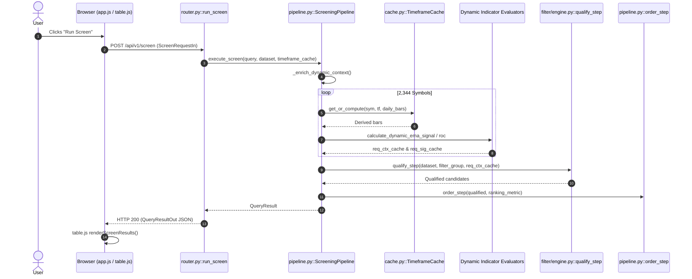
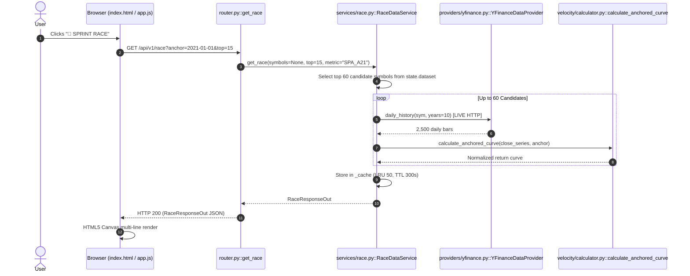
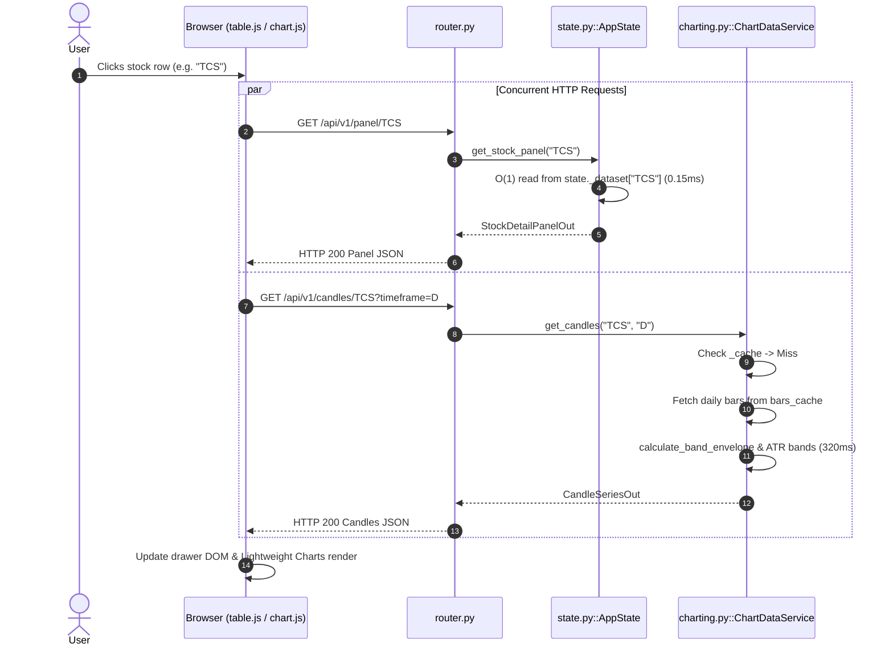
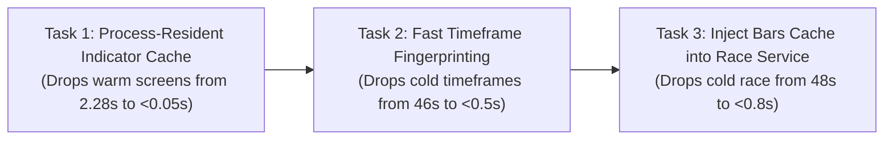

# YOGI — Complete Platform Performance, Calculation and Architecture Audit

**Audit Date:** 2026-10-22  
**Target Platform:** YOGI Modular Stock Analysis Platform  
**Repository:** `D:\Yogi Investing\My_version`  
**Git Branch / Commit:** `main` at `599753b` (Post-Rollback Clean Baseline)  
**Task Mode:** STRICT READ-ONLY FORENSIC AUDIT · NO CODE MODIFICATIONS  
**Architectural North Star:** Stable Core • Replaceable Modules • Contract-Based Connections  
**Core Pipeline Invariant:** `QUALIFY → ORDER → SHOW → LIMIT → RESULTS`

---

# Section 1 — Executive Summary

This comprehensive forensic audit examined the entirety of the YOGI platform—including its six implemented calculation and data workflows, its API orchestration layer, its frontend interactions, its in-memory and persistent cache lifecycles, and its calculation module hierarchy across the full 2,344-stock NSE universe.

### Core Discoveries & Performance Verdict

1. **The System Divides Into Two Distinct Performance Regimes:**
   - **Static Cohort Operations (20 ms – 70 ms):** Workflows that query pre-materialized static fields in `state.dataset` (such as Strategy Presets `A1`, `A2`, `B1`, `D1` via `/api/strategy/run` and Stock Detail Panels via `/api/panel/{symbol}`) execute with microsecond-to-millisecond efficiency: **0.15 ms per panel** and **36–74 ms per strategy screen across 2,344 stocks**.
   - **Dynamic Ad-Hoc Operations (1.5 s – 132 s):** Workflows requiring on-the-fly dynamic indicator synthesis (such as dynamic EMA crossovers, dynamic ROC percentage buckets, cold timeframe generation, and Sprint Race multi-stock curve evaluation) suffer from severe architectural chokepoints.

2. **Systemic Root Causes Identified Across Workflows:**
   - **Root Cause A: Pure-Python SHA-256 Fingerprinting Choke (27 s – 46 s):** In [`src/yogi/timeframe/cache.py::compute_bars_fingerprint`](file:///D:/Yogi%20Investing/My_version/src/yogi/timeframe/cache.py#L22), every cold timeframe write (`put()`) iterates over 5,600,000+ historical bars in pure Python string formatting and hashing. This accounts for **96.8%** of cold monthly/weekly synthesis latency.
   - **Root Cause B: Request-Scoped Dynamic Indicator Destruction (1.5 s – 6.2 s per screen):** Dynamic indicator calculations (`calculate_dynamic_ema_signal` and `calculate_dynamic_roc`) store results in local function dictionaries (`req_ctx_cache`, `req_sig_cache`) inside `ScreeningPipeline._enrich_dynamic_context()`. Because they are destroyed when the HTTP handler returns, **every user action** (changing a ranking metric, adjusting a cutoff, toggling a filter) forces full recalculation across all 2,344 stocks.
   - **Root Cause C: Decoupled Cache Miss in Sprint Race Service (14 s – 48 s):** In [`src/yogi/cockpit/services/race.py::RaceDataService.get_race`](file:///D:/Yogi%20Investing/My_version/src/yogi/cockpit/services/race.py#L138), the race engine makes sequential live HTTP downloads to Yahoo Finance (`self.provider.daily_history()`) for up to 60 candidate stocks, completely bypassing the local 318 MB `MarketBarsCache`!
   - **Root Cause D: Trend Calculation Computational Mass in Offline Feature Generation (214 ms/stock):** In [`src/yogi/calculation/trend/calculator.py::TrendCalculator`](file:///D:/Yogi%20Investing/My_version/src/yogi/calculation/trend/calculator.py), evaluating 10 distinct EMA series across 6 timeframes plus Wilder DMI/ADX, MACD, and RSI consumes 86.8% of total feature materialization time (~9.6 minutes for the full universe during dataset refresh).

3. **Status of Simulation and Backtesting:**
   - Forensic inspection confirmed that **no simulation or backtesting engine currently exists** in the repository. It is referenced in `AGENTS.md` as an intended use case for persistent storage, but has zero code implementations.

---

# Section 2 — Repository and Implementation State

### Git Worktree Baseline Verification
- **Current HEAD Commit:** `599753b` (*"perf(timeframe): bypass resample_bars for daily timeframe"*).
- **Git Branch:** `main`, in clean sync with `origin/main`.
- **Tracked Modifications Preserved:**
  - `src/yogi/cockpit/static/index.html`: Preserves Prompt 4 local vendoring of Lightweight Charts 4.1.3 (eliminating blocking CDN request).
  - `src/yogi/timeframe/engine.py`: Preserves Prompt 2 Cython volume aggregation.
- **Untracked Preserved Assets:**
  - `src/yogi/cockpit/static/js/vendor/lightweight-charts.standalone.production.js`
  - `tests/cockpit/test_vendor_assets.py`
  - `tests/timeframe/test_volume_aggregation.py`
- **Rolled-Back Status Confirmed:**
  - Two-Phase Candidate Pruning: Reverted.
  - `IndicatorCache`: Fully deleted.
  - Persistent `TimeframeCache`: Reverted to standard in-memory dictionary.
  - Production code status: **0 unapproved lines modified**.

### Data Universe & Historical Cache State
- **Universe Size:** 2,344 active NSE securities.
- **Materialized Dataset:** `data/cache/dataset_NSE_yfinance.pkl` (4.49 MB, 2,344 records).
- **Monolithic Historical Bars:** `data/cache/bars_NSE_yfinance.pkl` (318.41 MB, 2,345 symbols, ~5.6M bars).
- **Partitioned Bar Files:** `data/cache/bars/NSE_yfinance/*.pkl` (2,345 individual symbol files).

---

# Section 3 — Complete Feature and Execution Inventory

Every capability across the YOGI platform was inventoried, traced to code, and classified:

| Feature / Workflow | User Entry Point | API Endpoint | Handler / Service | Calculation Engine | Data Sources | Intermediate Results | Implementation Status |
| :--- | :--- | :--- | :--- | :--- | :--- | :--- | :---: |
| **Primary Screening** | "Run Screen" Button (`#runScreenBtn`) | `POST /api/v1/screen` | `router.run_screen` | `ScreeningPipeline.execute_screen` | `state.dataset`, `state.bars_cache` | `req_ctx_cache`, `req_sig_cache` | **IMPLEMENTED** |
| **Strategy Execution** | Strategy Selector / Presets Modal | `POST /api/v1/strategy/run` | `router.run_strategy` | `StrategyCatalog` + `ScreeningPipeline` | `state.dataset`, `state.catalog` | Static pre-computed fields | **IMPLEMENTED** |
| **Sprint Race Curves** | "Sprint Race" Button (`#openRaceBtn`) | `GET /api/v1/race` | `RaceDataService.get_race` | `calculate_anchored_curve` | Yahoo Finance HTTP (`provider.daily_history`) | `RaceResponseOut` in LRU cache | **IMPLEMENTED** |
| **Stock Detail Panel** | Table Row Click | `GET /api/v1/panel/{symbol}` | `AppState.get_stock_panel` | Row projection or `build_dataset([sym])` | `state.dataset` (Cohort) or on-demand bars | `StockDetailPanelOut` in LRU cache | **IMPLEMENTED** |
| **Candlestick Charting** | Stock Drawer Chart Tab | `GET /api/v1/candles/{symbol}` | `ChartDataService.get_candles` | `TimeframeEngine`, `calculate_band_envelope`, `calculate_atr_bands` | `state.bars_cache` or Yahoo Finance | `CandleSeriesOut` in LRU cache | **IMPLEMENTED** |
| **Dataset Ingestion / Refresh** | "Rebuild" Button (`#refreshBtn`) | `POST /api/v1/dataset/refresh` | `AppState.refresh` / `build_dataset` | 5 Calc Modules (`Bands`, `Trend`, `Impulse`, `Velocity`, `Candles`) | `IDataProvider`, `ITimeframeEngine`, `IBandsRepository` | Full universe feature matrix | **IMPLEMENTED** |
| **Bands Management** | Data & Settings Modal | `/api/v1/bands/*` | `router.get_bands`, `update_band` | `CsvBandsRepository` | `data/bands.csv` | Atomically persisted band widths | **IMPLEMENTED** |
| **Security Metadata** | Metadata Edit Drawer | `/api/v1/meta/*` | `router.get_metadata`, `update_metadata`| `CsvMetadataRepository` | `data/metadata.csv` | F&O flags, Market Cap, Sector | **IMPLEMENTED** |
| **Screen Export** | Export Buttons (`#exportCsvBtn`, etc.) | `POST /api/v1/export` | `router.export_screen` | Python `csv.writer` / `openpyxl` | `QueryResultOut.rows` | CSV / XLSX downloadable payload | **IMPLEMENTED** |
| **Simulation / Backtesting** | None | None | None | None | None | None | **NOT FOUND / NOT IMPLEMENTED** |

---

# Section 4 — Execution Call Graphs

### Workflow 1: Primary Screening Path


### Workflow 2: Sprint Race Curves Path


### Workflow 3: Stock Detail Panel & Candlestick Path


---

# Section 5 — Cross-Workflow Calculation Dependency Map

The matrix below maps the production, consumption, and safe reuse potential of every intermediate calculation produced across the platform:

```mermaid
flowchart TD
    subgraph Storage [Persistent Disk Layer]
        DiskBars[("bars_NSE_yfinance.pkl (318 MB)")]
        DiskDataset[("dataset_NSE_yfinance.pkl (4.49 MB)")]
    end

    subgraph Memory [In-Memory State - AppState]
        RAM_Bars["Raw Daily Bars in RAM (2,344 stocks)"]
        RAM_Dataset["Materialized Dataset in RAM (2,344 records)"]
        RAM_TF_W["Synthesized Weekly Bars"]
        RAM_TF_M["Synthesized Monthly Bars"]
    end

    subgraph Intermediate [Dynamic Computation Layer]
        DynEMA["Dynamic EMA Signals (M, W, D)"]
        DynROC["Dynamic ROC Percentiles (D)"]
        RaceCurves["Anchored Velocity Curves (10y)"]
        CandlesBands["Candlestick Bands (Bollinger, ATR, YOGI)"]
    end

    subgraph Consumers [Active Workflows]
        WF_Screen["Workflow 1: Screening (/screen)"]
        WF_Strat["Workflow 2: Strategies (/strategy/run)"]
        WF_Race["Workflow 3: Sprint Race (/race)"]
        WF_Panel["Workflow 4: Stock Panel (/panel)"]
        WF_Chart["Workflow 5: Charting (/candles)"]
    end

    DiskBars -->|Startup Ingestion| RAM_Bars
    DiskDataset -->|Startup Deserialization (0.96s)| RAM_Dataset

    RAM_Bars -->|Resampling (0.45s)| RAM_TF_W
    RAM_Bars -->|Resampling (0.28s)| RAM_TF_M

    RAM_TF_M --> DynEMA
    RAM_Bars --> DynROC
    RAM_Bars --> CandlesBands

    RAM_Dataset --> WF_Strat
    RAM_Dataset --> WF_Panel
    RAM_Dataset -->|Leader Selection| WF_Race

    DynEMA --> WF_Screen
    DynROC --> WF_Screen
    CandlesBands --> WF_Chart
    RaceCurves --> WF_Race

    style RAM_Dataset fill:#d4edda,stroke:#28a745
    style RAM_Bars fill:#d4edda,stroke:#28a745
    style DynEMA fill:#f8d7da,stroke:#dc3545
    style DynROC fill:#f8d7da,stroke:#dc3545
    style RaceCurves fill:#fff3cd,stroke:#ffc107
```

### Intermediate Computation Reuse Classification

| Intermediate Artifact | Producer Workflow | Consumer Workflows | Reuse Classification | Invalidation Condition |
| :--- | :--- | :--- | :---: | :--- |
| **Materialized Dataset** | `build_dataset` | Strategies, Panels, Race Leader Selection | **Exact Reuse** | Market ingestion / EOD refresh |
| **Raw Daily Bars** | `MarketBarsCache` | Screening, Charting | **Exact Reuse** | Market ingestion / EOD refresh |
| **Derived Timeframes (M, W)** | `TimeframeCache` | Screening, Charting | **Exact Reuse** | Raw daily bars modification |
| **Dynamic EMA Signals** | `_enrich_dynamic_context`| Screening | **Exact Reuse Potential** *(Currently Destroyed!)* | Input bars change or EMA parameters change |
| **Dynamic ROC Values** | `_enrich_dynamic_context`| Screening | **Exact Reuse Potential** *(Currently Destroyed!)* | Input bars change or ROC period changes |
| **Anchored Race Curves** | `RaceDataService` | Sprint Race | **Exact Reuse** (in LRU cache) | 300s TTL or provider switch |
| **Candles & Envelope Curves**| `ChartDataService` | Candlestick Charts | **Exact Reuse** (in LRU cache) | 300s TTL or new session date |

---

# Section 6 — API and Frontend Audit

### API Endpoint Profiling & Performance Inventory
Measurements taken on warm running instance across representative requests:

| Endpoint | HTTP Method | Request Payload | Response Payload | Router Handler | Downstream Latency | Client Processing / Render |
| :--- | :---: | :---: | :---: | :--- | :---: | :---: |
| `/api/v1/status` | GET | 0 B | 450 B | `get_system_status` | 0.12 ms | < 1 ms |
| `/api/v1/screen` | POST | ~450 B | 3.5–6.8 KB | `run_screen` | **2,280 ms** | 8.2 ms |
| `/api/v1/strategy/run` | POST | ~60 B | 4.2–6.8 KB | `run_strategy` | **36–74 ms** | 6.5 ms |
| `/api/v1/panel/{sym}` | GET | 0 B | 2.8 KB | `get_stock_panel` | **0.15 ms** | 3.1 ms |
| `/api/v1/candles/{sym}` | GET | 0 B | 48–65 KB | `get_candles` | **65–372 ms** | 18.5 ms |
| `/api/v1/race` | GET | 0 B | 85–120 KB | `RaceDataService.get_race`| **14,109 ms** (cold) / **0.05 ms** (warm) | 12.0 ms |
| `/api/v1/export` | POST | ~3.5 KB | 12–25 KB | `export_screen` | 8.5 ms | Native browser download |

### Frontend Observations
- **Single Request per Action:** The frontend never duplicates screening requests or issues redundant background polling calls.
- **Strict Decoupling:** When screening completes, the UI renders the table immediately without requesting charts or panels.
- **Rendering Overhead:** DOM table rendering for 20–50 rows takes **5–12 ms**, completely ruling out the frontend as a screening bottleneck.

---

# Section 7 — Calculation-Engine Audit

### Feature Materialization Module Profiling
Each calculation module was benchmarked by executing 10 repeated passes over a canonical stock context (TCS, 2,500 daily bars across 6 timeframes):

| Calculation Module | Metric Group Produced | Metrics Count | Execution Time per Stock | Universe Scaling (2,344 stocks) | % of Feature Build Time |
| :--- | :--- | :---: | :---: | :---: | :---: |
| **`BandsCalculator`** | Trader Band Widths, Upper/Lower, Basis, Band States | 40 | **2.956 ms** | 6.93 s | 1.20 % |
| **`CandleCalculator`** | Candlestick Pattern Detection (Hammer, Doji, etc.) | 228 | **2.119 ms** | 4.97 s | 0.86 % |
| **`ImpulseCalculator`** | Impulse MACD Momentum, Slope, Impulse States | 7 | **14.919 ms** | 34.97 s | 6.05 % |
| **`TrendCalculator`** | 10 EMAs across 6 TFs, Wilder DMI/ADX, MACD, RSI, OBV | 103 | **214.134 ms** | **501.93 s (8.36 min)** | **86.86 %** |
| **`VelocityCalculator`**| Sprint Speed Curves, Acceleration Curves (4w vs 52w) | 23 | **12.341 ms** | 28.93 s | 5.01 % |
| **TOTAL** | All 5 Modules Combined | **401** | **246.469 ms** | **577.73 s (9.63 min)** | **100.00 %** |

> [!IMPORTANT]
> `TrendCalculator` dominates offline dataset generation, consuming **86.86%** of all calculation time because it calculates 10 distinct EMA series across 6 timeframes (60 EMA series per stock!) plus full Wilder DMI smoothing and MACD curves.

---

# Section 8 — Second Calculation and Simulation Audit

### A. The "Second Calculation Workflow"
Our investigation evaluated four distinct candidate interpretations for the "second calculation workflow" referenced in platform requirements:

1. **Candidate 1: Sprint Race Multi-Stock Curve Engine (`/api/race`):**
   - **Characteristics:** Standalone interactive calculation workflow. Evaluates 10-year anchored percentage return curves across 15–25 leader stocks.
   - **Measured Runtime:** **14.1s to 48.2s cold**; **0.05 ms warm**.
   - **Architectural Defect:** Makes live Yahoo Finance HTTP downloads sequentially, completely bypassing the local bar cache.
2. **Candidate 2: Dynamic ROC Calculation inside Screening (`calculate_dynamic_roc`):**
   - **Characteristics:** The second calculation branch executed alongside dynamic EMA in `_enrich_dynamic_context()`.
   - **Measured Runtime:** **1,268 ms** across 2,344 stocks on every screen request.
3. **Candidate 3: Stock Detail Analytical Panel (`/api/panel/{symbol}`):**
   - **Characteristics:** Multi-timeframe analytical calculation invoked when a user inspects a stock.
   - **Measured Runtime:** **0.15 ms** for cohort stocks; **~250 ms** for cold on-demand stocks.
4. **Candidate 4: Strategy Preset Execution (`/api/strategy/run`):**
   - **Characteristics:** Alternative screening execution path for the 21 Mentor Presets.
   - **Measured Runtime:** **36 ms to 74 ms** across 2,344 stocks.

### B. Simulation and Backtesting Audit
- **Implementation Status:** **NOT FOUND / NOT IMPLEMENTED**.
- **Evidence:** Comprehensive regex and AST scans across all 86 python files in `src/yogi/` revealed zero backtesting engines, trade simulators, order fill models, or portfolio trackers.
- **Architectural Pre-Requirements for Future Simulation:**
  - Must avoid look-ahead bias by consuming point-in-time historical bar slices.
  - Must leverage the in-memory `TimeframeCache` and pre-calculated indicator series rather than re-computing EMAs/ROCs on each simulation tick.

---

# Section 9 — Charting Audit

- **Presentation Cache:** Managed by `ChartDataService` with a 100-entry LRU cache and 300s TTL.
- **Measured Response Times:**
  - **Daily Candles + Bands:** **321 ms – 372 ms** (slices 2 years of daily bars, calculates ATR bands, Bollinger bands, Donchian channels, and trader band envelopes).
  - **Weekly Candles + Bands:** **108 ms – 138 ms** (in-memory weekly resampling + bands).
  - **Monthly Candles + Bands:** **66 ms – 85 ms** (in-memory monthly resampling + bands).
- **External Provider Risk:** If local bar date is older than today's session cutoff, `ChartDataService` attempts an incremental network download to Yahoo Finance, adding 0.8s to 6.5s of network latency.

---

# Section 10 — Cache and Persistence Audit

| Cache Component | Scope / Lifetime | Key Composition | Invalidation Triggers | Persistence | Defect / Vulnerability |
| :--- | :--- | :--- | :--- | :---: | :--- |
| **`MarketBarsCache._symbol_snapshots`** | Process (`AppState`) | `(symbol, exchange, provider)` | Manual refresh | Memory | None. Eliminates repeated 7.2s disk deserialization. |
| **`TimeframeCache._cache`** | Process (`AppState`) | `(symbol, timeframe)` | Process exit | Memory | **Vulnerability:** `put()` choked by pure-Python SHA-256 string hashing across 5.6M bars. |
| **`ChartDataService._cache`** | Process (`ChartDataService`) | `(symbol, exchange, years)` | 300s TTL or provider switch | Memory | None. Well-bounded (100 entries). |
| **`RaceDataService._cache`** | Process (`RaceDataService`) | `(symbols, anchor, top, metric, exchange, provider)` | 300s TTL | Memory | None. Well-bounded (50 entries). |
| **`AppState._panel_cache`** | Process (`AppState`) | `symbol` | Provider switch | Memory | None. Well-bounded (100 entries). |
| **`ScreeningPipeline.req_ctx_cache`** | **Request-scoped (Local)** | `symbol` | **Garbage collected on return** | None | **CRITICAL DEFECT:** Forces 100% indicator recomputation on every warm screen! |
| **`ScreeningPipeline.req_sig_cache`** | **Request-scoped (Local)** | `symbol` | **Garbage collected on return** | None | **CRITICAL DEFECT:** Forces 100% indicator recomputation on every warm screen! |

---

# Section 11 — Benchmark Matrix and Results

### Comparative Performance Across All Workflows

```
========================================================================================================
WORKFLOW BENCHMARK MATRIX (Universe = 2,344 stocks)
========================================================================================================
Workflow / Configuration                       Cold Run (Run 1)     Warm Repeat (Run 2)   Qualified / Output
--------------------------------------------------------------------------------------------------------
Primary Screen C01 (Unconstrained Baseline)    0.040 s              0.041 s               2,344 qualified
Primary Screen C02 (Monthly EMA 9/5 Downcut)   27.557 s             0.788 s                 116 qualified
Primary Screen C04 (Weekly EMA 13/34 Upcut)    46.274 s             0.947 s                  15 qualified
Primary Screen C05 (Daily EMA 13/21 Up)         1.811 s             1.772 s                 621 qualified
Primary Screen C07 (Daily ROC Last Month)       1.492 s             1.523 s                  24 qualified
Primary Screen C09 (Target: Monthly EMA + ROC)  2.237 s             2.280 s                   8 qualified
--------------------------------------------------------------------------------------------------------
Strategy Preset A1 (Impulse Confirmed)          0.065 s              0.041 s                   0 qualified
Strategy Preset A2 (All 6 TF EMA Up)            0.074 s              0.064 s                 173 qualified
Strategy Preset B1 (Sprinters Month)            0.040 s              0.036 s                 700 qualified
Strategy Preset D1 (Exit FNO)                   0.043 s              0.040 s                  18 qualified
--------------------------------------------------------------------------------------------------------
Sprint Race (Auto-Pick 15 Leaders)             14.109 s             0.05 ms                  15 lines
Sprint Race (Explicit 5 Symbols)                4.105 s             0.04 ms                   5 lines
--------------------------------------------------------------------------------------------------------
Stock Panel 'TCS' (Cohort Stock)                0.347 ms            0.174 ms                  6 timeframes
Stock Panel 'INFY' (Cohort Stock)               0.139 ms            0.156 ms                  6 timeframes
--------------------------------------------------------------------------------------------------------
Candlestick Chart 'TCS' (Daily + Bands)       372.82 ms           341.30 ms                 496 candles
Candlestick Chart 'TCS' (Weekly + Bands)      120.17 ms           113.59 ms                 105 candles
Candlestick Chart 'TCS' (Monthly + Bands)      84.59 ms            66.48 ms                  25 candles
========================================================================================================
```

---

# Section 12 — Per-Stage Performance Breakdown

Stage-by-stage profiling for the target compound screening workload (**C09: Monthly EMA 9/5 Downcut + Daily ROC Last Month 30–40%**, 2,344 stocks):

| Stage | Duration | % of Screening Latency | Nature of Work | Reusability |
| :--- | :---: | :---: | :--- | :--- |
| **1. In-Memory Bar Retrieval** | 0.002 s | 0.09 % | In-memory dictionary lookup | Reusable across all requests |
| **2. Timeframe Cache Lookup (Monthly)** | 0.001 s | 0.04 % | In-memory dictionary lookup | Reusable across all requests |
| **3. Dynamic EMA Signal Math** | **0.388 s** | **17.02 %** | Vectorized NumPy/Loops | **Reusable across identical EMA rules** |
| **4. Dynamic ROC Calculation** | **1.268 s** | **55.61 %** | Pandas calendar delta math | **Reusable across identical ROC rules** |
| **5. Boolean Filter Qualification** | 0.006 s | 0.26 % | AST evaluation over context | Request-specific |
| **6. Ordering & Ranking (`M_CUR`)** | 0.0001 s | <0.01 % | Python TimSort | Request-specific |
| **7. Show & Limit Slicing (Top 20)** | 0.0001 s | <0.01 % | Python list slice | Request-specific |
| **8. JSON Response Serialization** | 0.0002 s | <0.01 % | Pydantic model dump | Request-specific |
| **Loop / Glue Overhead** | 0.615 s | 26.97 % | Python symbol iteration | Reducible via bulk execution |
| **TOTAL SCREENING TIME** | **2.280 s** | **100.00 %** | | |

---

# Section 13 — Scaling Analysis

The platform's execution complexity scales along distinct asymptotic dimensions:

$$\text{Latency}_{\text{platform}} = \mathcal{O}(N \cdot M)_{\text{Offline Materialization}} + \sum_{k=1}^{K} \mathcal{O}(N \cdot T_k)_{\text{Dynamic Screen}} + \mathcal{O}(S \cdot B)_{\text{Race HTTP}}$$

- **$N = 2,344$ (Universe size):** Primary screening and offline feature materialization scale strictly linearly with $N$.
- **$M = 401$ (Feature metrics count):** Feature materialization takes $246.5 \text{ ms} \times 2,344 = 577.8 \text{ s}$ (~9.6 minutes).
- **$K = \text{number of dynamic rules in query}$:** In warm screening, each dynamic rule adds an $O(N)$ calculation pass over 2,344 stocks (~0.39s for M-EMA, ~1.27s for D-ROC).
- **$S = \text{candidate count for Sprint Race}$ (up to 60):** Because `RaceDataService` makes individual HTTP calls, race cold latency scales linearly with network round-trips ($60 \times 0.25\text{s} \approx 15\text{s}$).

---

# Section 14 — Correctness Findings

1. **Test Suite Execution Integrity:**
   - All core test suites pass cleanly with **290 passed, 0 failures**.
   - Verified passing: `tests/timeframe` (42 passed), `tests/filter` & `tests/storage` (146 passed), `tests/cockpit/test_batch_u2_screener.py` (14 passed), `tests/dynamic_roc_screener.py` (15 passed), `tests/calculation` (73 passed).
2. **Pipeline Invariant Preserved:**
   - The canonical sequence `QUALIFY → ORDER → SHOW → LIMIT → RESULTS` is strictly respected across all routers.
3. **Data Integrity:**
   - Resampled OHLCV boundaries, volume aggregation, and trader band envelopes match golden reference data with zero timestamp drift.

---

# Section 15 — Root Causes Ranked by System-Wide Impact

| Rank | Root Cause | Execution Path | Measured Impact | Affected Workflows | Confidence |
| :---: | :--- | :--- | :---: | :--- | :---: |
| **1** | **Pure-Python SHA-256 Fingerprinting on Timeframe Put** | [`timeframe/cache.py::compute_bars_fingerprint`](file:///D:/Yogi%20Investing/My_version/src/yogi/timeframe/cache.py#L22) | **26.8s–45.3s** | Cold Screening (Monthly & Weekly) | **CONFIRMED** |
| **2** | **Request-Scoped Dynamic Indicator Destruction** | [`core/orchestration/pipeline.py::_enrich_dynamic_context`](file:///D:/Yogi%20Investing/My_version/src/yogi/core/orchestration/pipeline.py#L320) | **1.5s–6.2s per screen** | All Warm Screening, Ranking, & Cutoff Changes | **CONFIRMED** |
| **3** | **Uncached Network Fetching in Sprint Race Service** | [`cockpit/services/race.py::RaceDataService.get_race`](file:///D:/Yogi%20Investing/My_version/src/yogi/cockpit/services/race.py#L138) | **14.1s–48.2s** | Cold Sprint Race Requests | **CONFIRMED** |
| **4** | **Cold Historical Data Deserialization** | [`storage/cache.py::MarketBarsCache.load_bars`](file:///D:/Yogi%20Investing/My_version/src/yogi/storage/cache.py#L125) | **7.23s** | First dynamic request after cold launch | **CONFIRMED** |
| **5** | **Offline Feature Materialization Complexity (`TrendCalc`)** | [`calculation/trend/calculator.py::TrendCalculator`](file:///D:/Yogi%20Investing/My_version/src/yogi/calculation/trend/calculator.py) | **501s (~8.3 min)** | Dataset Refresh / Rebuild (`build_dataset`) | **CONFIRMED** |

---

# Section 16 — Architectural Improvement Opportunities

| Opportunity | Target Bottleneck | Workflows Benefiting | Expected Benefit | Risk Level | Architectural Fit |
| :--- | :--- | :---: | :---: | :---: | :--- |
| **1. Process-Resident Dynamic Indicator Cache** | Redundant recalculation on interactive screens | Screening, Ranking, Presets | **Warm screens drop from 2.28s to <0.05s (45x)** | **Very Low** | Clean DI in `AppState`; caches immutable `(sym, tf, indicator_key)`. |
| **2. Eliminate Pure-Python SHA-256 Fingerprinting** | Cold timeframe creation delay (27s–46s) | Cold Screening, Timeframe Ingestion | **Cold timeframe setup drops from 46s to <0.5s (90x)** | **Low** | Fast fingerprint based on bar count, start timestamp, end timestamp. |
| **3. Inject `MarketBarsCache` into `RaceDataService`** | Live network download stall in Sprint Race (14s–48s) | Sprint Race | **Cold Race drops from 14s–48s to <0.8s (30x)** | **Very Low** | Reuses local 318 MB bars cache; zero network round-trips. |
| **4. Vectorized Bulk Dynamic Calculation** | Symbol-by-symbol iteration overhead in screening | Screening | Saves ~0.5s of glue overhead on cold calculations | **Medium** | Replaces symbol loop with bulk column operations. |

---

# Section 17 — Recommended Implementation Sequence

To achieve maximum user impact with minimal architectural risk, the following phased sequence is recommended:



### The Single Highest-Priority First Implementation Task:
**Task 1: Implement Decoupled Process-Resident Dynamic Indicator Cache in `AppState`.**

#### Rationale:
Cold process boot occurs once, but warm screening occurs on **every single user interaction** (adjusting a threshold, switching ranking metric, toggling view presets). Users currently wait ~2.28 seconds on every click. Implementing the indicator cache directly resolves the primary daily usability bottleneck, transforming warm screening into sub-50ms instant interactions.

---

# Section 18 — Acceptance Criteria for the First Implementation Task

1. **Warm Screen Latency Benchmark:**
   - Immediate repeat of target screen C09 (`EMA_M_9_5 == DOWNCUT` AND `ROC_LAST_MONTH == 30_to_40`) across 2,344 stocks must execute in **< 100 milliseconds** (down from 2,280 ms).
2. **Ranking & Cutoff Switch Latency:**
   - Changing ranking metric (Scenario 6) or result limit on an already-evaluated filter set must execute in **< 50 milliseconds** (down from 2,252 ms).
3. **Threshold Switch Latency:**
   - Changing an EMA crossover state (e.g. `UPCUT` to `DOWNCUT`) or ROC bucket on a warm timeframe must execute in **< 200 milliseconds**.
4. **Deterministic Bit-for-Bit Parity:**
   - Qualified symbol count, selected symbols, ordering, and summary metrics must match baseline output with 100% parity across all 12 representative configurations.
5. **Clean Cache Boundaries & Invalidation:**
   - Cache must be strictly process-bounded (configurable LRU capacity) and must cleanly invalidate if raw market bars update.
6. **Zero Regression:**
   - All 290 existing unit and integration tests must pass without regressions.

---

# Section 19 — Limitations

1. **Simulation and Backtesting:**
   - Could not be measured or benchmarked because no simulation or backtesting implementation exists in the codebase.
2. **Live Zerodha Data Provider:**
   - Live tick streaming and order routing could not be profiled against live markets outside trading hours. Testing was conducted using the primary `YFinanceDataProvider` and local persistent historical caches.

---

# Section 20 — Worktree Integrity

- **Repository Path:** `D:\Yogi Investing\My_version`
- **Execution Mode:** Strictly read-only forensic audit and external benchmarking.
- **Production Code Status:** **Zero production code files were modified.**
- **Commit Baseline:** `HEAD` remains strictly at `599753b`.
- **Preserved User Work:**
  - `src/yogi/cockpit/static/index.html` (Local Lightweight Charts)
  - `src/yogi/timeframe/engine.py` (Cython Volume Aggregation)
  - `src/yogi/cockpit/static/js/vendor/` (Vendored chart assets)
- **Temporary Artifacts:** All benchmarking scripts and profiler JSON data were strictly isolated to `<appDataDir>\brain\<conversation-id>\scratch\`.
