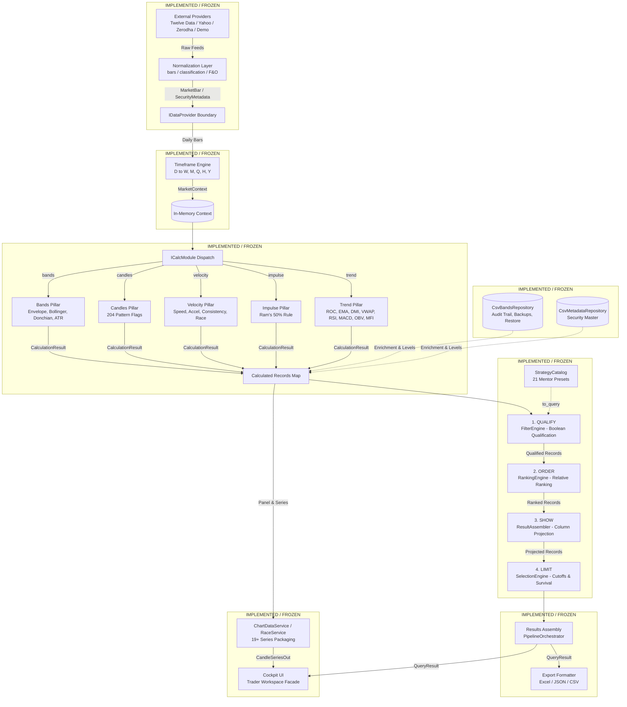

# YOGI — System Overview & Developer Onboarding Baseline

> **Stable Core • Replaceable Modules • Contract-Based Connections**

This document is the high-level entry point and orientation map for YOGI. It is designed to enable a new developer or coding agent—with zero prior conversation history—to quickly understand what YOGI is, how it is designed, what is currently implemented, what comes next, and how to safely make modifications.

---

## 1. Twenty Essential Onboarding Questions

### 1. What is YOGI?
YOGI is a modular, high-performance stock analysis and screening platform engineered for systematic momentum, relative strength, and structural technical investing in Indian equities (NSE and BSE).

### 2. What problem is it solving?
Legacy financial screening tools often combine data ingestion, mathematical formulas, filtering conditions, ranking logic, and user interface presentation into monolithic scripts with hidden state. YOGI eliminates this architectural debt by decoupling each concern into strictly bounded, independently testable, replaceable components governed by frozen contracts.

### 3. What is the architectural philosophy?
- **Stable Core**: The center of the system coordinates execution without containing concrete domain implementations.
- **Replaceable Modules**: Every provider, calculation, and storage engine can be swapped with zero blast radius on surrounding components.
- **Contract-Based Connections**: Cross-module communication occurs exclusively via strongly typed, frozen abstract interfaces. Core depends on contracts, never on concrete vendor implementations.
- **Preserve → Refactor → Extend**: Established mathematical models and financial algorithms from the verified prototype serve as sources of truth.
- **Minimalism**: Abstractions are only introduced when justified by an active architectural boundary or current requirement.

### 4. What are the major layers?
```text
src/yogi/
├── core/         # Invariant center: contracts, registry, configuration, orchestration
├── data/         # External provider adapters, resilient source fetchers, pure normalizers (bars, classification, F&O)
├── storage/      # Persistent storage: CsvBandsRepository (Batch 4), CsvMetadataRepository (Batch 5)
├── timeframe/    # Multi-timeframe candle synthesis (D -> W, M, Q, H, Y)
├── calculation/  # Five Analytical Mathematical Pillars (Bands, Candles, Impulse, Trend, Velocity)
├── filter/       # Qualification engine: "Does it qualify?" (QUALIFY)
├── ranking/      # Relative universe ordering: "Where does it stand?" (ORDER)
├── selection/    # Rank cutoffs & cohort survival: "Does its rank qualify?" (LIMIT)
├── strategy/     # Strategy composition and 21 Mentor Presets
├── results/      # Presentation payload assembly and exports (SHOW/RESULTS)
├── pipeline/     # Canonical screening orchestrator implementation
└── cockpit/      # Interactive trader workspace UI, REST API, and charting services
```

### 5. How does data flow through the system?
```text
External Market Feed (Yahoo / Zerodha / Twelve Data / Demo)
         ↓
Data Provider Adapter (IMarketDataProvider)
         ↓
Pure Normalizers (bars, instrument classification, official NSE F&O list)
         ↓
Canonical DTOs (MarketBar / TickData / SecurityMetadata)
         ↓
Timeframe Engine (synthesizes D into W, M, Q, H, Y)
         ↓
MarketContext (in-memory multi-timeframe container)
         ↓
Calculation Modules (Bands, Candles, Impulse, Trend, Velocity)
         ↓
Calculated Records (in-memory feature map keyed by symbol)
         ↓
QUALIFY (Filter Engine) → ORDER (Ranking Engine) → SHOW (ResultAssembler) → LIMIT (SelectionEngine)
         ↓
Results Assembly (IResultAssembler) → Cockpit UI / Excel / JSON
```

### 6. What are the current contracts?
All contracts reside in `src/yogi/core/contracts/` and are frozen:
- `market_data.py`: `MarketBar`, `TickData`, `MarketContext`, `Timeframe`, `IMarketDataProvider`, `ITickDataProvider`.
- `provider.py`: `IDataProvider`, `ProviderHealth`.
- `timeframe.py`: `ITimeframeSynthesizer`.
- `calculation.py`: `ICalcModule`, `CalculationContext`, `CalculationResult`.
- `bands.py`: `IBandsRepository`, `BandEntry`, `BandAuditEntry`, `BandBackupInfo`, `BAND_TIMEFRAMES`.
- `security.py`: `SecurityMetadata`, `InstrumentType`, `TradingGroup`, `ISecurityMetadataRepository`.
- `filter.py`: `IFilterRule`, `FilterGroupSpec`, `FilterRuleSpec`, `IFilterEngine`.
- `ranking.py`: `IRankingRule`, `RankingOrder`, `RankingMethod`, `IRankingEngine`.
- `selection.py`: `ISelectionRule`, `RankCutoffSpec`, `SelectionMode`, `ISelectionEngine`.
- `strategy.py`: `IStrategy`, `StrategySpec`, `IStrategyEngine`.
- `results.py`: `IResultAssembler`, `IExportFormatter`, `ColumnDefinition`, `QueryResultPayload`.

### 7. What does the registry do?
`RegistryHub` (`src/yogi/core/registry/`) maps capability contracts to available implementations. Per [ADR-004](decisions.md#adr-004-registryhub-scope-and-capability-resolution), it is strictly limited to three approved categories:
1. `providers`: `CapabilityRegistry[IDataProvider]`
2. `calculations`: `CapabilityRegistry[ICalcModule]`
3. `bands`: `CapabilityRegistry[IBandsRepository]`
It is **not** a universal registry. Filtering, ranking, selection, and results are single fixed engines driven by configuration data; strategies are declarative recipes managed by `StrategyCatalog`.

### 8. What does configuration do?
Configuration (`src/yogi/core/configuration/`) answers: *"What does YOGI want to do?"*
- `EngineConfig`: System-level pipeline configuration specifying runtime scope and capability keys (`provider`, `bands_repository`, `calculation_modules`, `exchange`, `timeframes`).
- `ScreeningQuery`: User screening intent strictly mapping to `QUALIFY → ORDER → SHOW → LIMIT`. It deliberately excludes display column projection per [ADR-005](decisions.md#adr-005-core-configuration-scope-and-screeningquery-separation).
- `StrategyCatalog`: In-memory catalog of named `StrategySpec` recipes, translating recipes into executable `ScreeningQuery` instances.

### 9. What does orchestration do?
`PipelineOrchestrator` (`src/yogi/pipeline/orchestrator.py`) coordinates execution across registry capabilities and screening contract stages. It establishes two clean boundaries:
- `build_dataset(config)`: Coordinates data acquisition, timeframe synthesis, calculation dispatch, and metadata enrichment into an in-memory feature map.
- `execute_screen(query, records, ...)`: Executes screening intent strictly through `QUALIFY → ORDER → SHOW → LIMIT → RESULTS`.
- `run(config, query)`: Convenience end-to-end execution.
Orchestration coordinates the pipeline; it contains zero mathematical formulas, resampling logic, or filtering algorithms.

### 10. What are the calculation modules?
The Calculation Engine (`src/yogi/calculation/`) organizes verified analytics into five modules satisfying `ICalcModule`:
1. **Bands (`"bands"`)**: Volatility envelope levels, positions, states (`ABOVE`, `BELOW`, `IN`, `na`), Bollinger Bands ($\mu \pm k\sigma$), Donchian Channels ($N$-period High/Low), ATR Volatility Bands, and continuous Band Distance curves.
2. **Candles (`"candles"`)**: Multi-timeframe candlestick shape metrics and 204 pattern recognition flags (`BULL_ENGULF`, `DOJI`, `HAMMER`, `MARUBOZU`, `INSIDE_BAR`, `OUTSIDE_BAR`, `NR7`, `WR7`, `THREE_UP`, `THREE_DN`, `GAP_UP`, `GAP_DN`).
3. **Impulse (`"impulse"`)**: Zigzag reversal swings and Ram's 50% recovery validation (`IC="IP"|"CR"|"up"|"na"`).
4. **Trend (`"trend"`)**: Trailing ROCs (`DROC`..`YROC`), calendar blocks, multi-year CAGRs, ATH diff, EMA 3/5 ribbon states, DMI/ADX, Average Price, VWAP, Relative Strength Index (RSI 14), Moving Average Convergence Divergence (MACD 12/26/9), On-Balance Volume (OBV), Money Flow Index (MFI 14), and continuous ROC curves.
5. **Velocity (`"velocity"`)**: Rolling speeds (`S4`..`S52`), linear accelerations (`ACCEL_S`, `ACCEL_L`), sprint consistency (`SPR_CONSIST`), anchored sprint race curves indexed to 100 (`/api/race`), continuous sprint speed curves, and continuous acceleration curves.

### 11. How does screening work?
Screening processes calculated records through a sequential, non-overlapping pipeline:
1. **Filter Engine (QUALIFY)**: Qualifies candidates using boolean predicates (`FilterGroupSpec`). Non-qualifying candidates are eliminated.
2. **Ranking Engine (ORDER)**: Computes relative ordering across qualified candidates based on analytical metrics (`ranking_metric`), injecting `RANK_{metric}` and rank change `RANK_CHG`. No candidates are dropped.
3. **Result Assembler (SHOW)**: Projects requested columns and enriches records with metadata (`name`, `sector`, `grade`, `mcap`, `fno`, `instr`, `grp`).
4. **Selection Engine (LIMIT)**: Evaluates rank cutoffs (`RankCutoffSpec`, e.g. Top N, sustained duration) to determine which ranked candidates survive into the final screen.
5. **Results Package (RESULTS)**: Packages records into an immutable `QueryResult` with execution timing and metadata.

### 12. What is QUALIFY → ORDER → SHOW → LIMIT → RESULTS?
The simple, unified mental model for screening:
- **QUALIFY** (Filter) = Determines whether a record satisfies criteria.
- **ORDER** (Ranking) = Determines relative standing among qualified records.
- **SHOW** (ResultAssembler) = Determines which columns and metadata fields are displayed.
- **LIMIT** (Selection) = Determines which ranked records are selected according to cutoff rules.
- **RESULTS** (Orchestration) = Packages the final immutable output payload.

### 13. What is the relationship between strategy and screening?
`IStrategy` and `StrategySpec` are declarative **configuration and composition recipes**, not a replacement for the screening pipeline. A strategy (such as one of the 21 Verified Mentor Presets) bundles qualification conditions, ranking metrics, and selection cutoffs into a reusable named recipe. Users can execute screens using a strategy recipe or by directly submitting a custom `ScreeningQuery`.

### 14. What is implemented?
Steps 1 through 11, Batches 1 through 5, and architectural findings YOGI-F01 through YOGI-F06 are **COMPLETED and FROZEN**:
- Foundation packaging and pytest infrastructure.
- All 10 Core Contracts and invariant DTOs.
- `CapabilityRegistry` and `RegistryHub` (3 categories).
- `EngineConfig`, `ScreeningQuery`, and `StrategyCatalog`.
- `PipelineOrchestrator` (`build_dataset`, `execute_screen`, `run`).
- Yahoo Finance, Zerodha Kite, Twelve Data, and Demo market data providers (`src/yogi/data/providers/demo.py`) with pure normalizers.
- Instrument Classification (`InstrumentClassifier`) and official NSE F&O Universe Discovery (`NseFnoUniverse`, `sources/nse.py`).
- Pure Timeframe Engine synthesizing `D` into `W`, `M`, `Q`, `H`, `Y`.
- All Five Calculation Pillars (Bands, Candles, Impulse, Trend, Velocity) with centralized band envelope math (`calculate_band_envelope()`).
- Full technical indicator and oscillator suite: Bollinger Bands, Donchian Channels, ATR Volatility Bands, VWAP, Average Price, RSI, MACD, OBV, MFI, and YOGI custom curves (Sprint Speed, Acceleration, Band Distance, YOGI ROC).
- Screening Engine (`FilterEngine`, `RankingEngine`, `SelectionEngine`, and the 21 Verified Mentor Presets in `Strategy`).
- Results Engine (`ResultAssembler`, `ExportFormatter` for XLSX, CSV, JSON byte streams, and column categorization).
- Persistent Storage Engine (`src/yogi/storage/`): `CsvBandsRepository` (manual bands, audit trail, daily backups, restore) and `CsvMetadataRepository` (security master metadata) with atomic `.tmp` staging and crash resilience.
- Cockpit Layer (`src/yogi/cockpit/`): FastAPI application factory, REST API endpoints, `AppState` with deeply immutable `MappingProxyType` dataset cache, on-demand Stock Detail Drawer resolution (F05), bounded LRU chart data cache (F04), `ColumnProjectingAssembler`, `ChartDataService` packaging 19+ financial series via `CandleSeriesOut`, `RaceVisualizerService` (`/api/race`), and dark-theme TradingView Lightweight Charts dashboard.
- Full test suite: **557 passed** across unit, integration, live smoke, golden regression, and Batch 1–5 parity suites (0 failures).

### 15. What is not implemented?
- **Mentor Review & Final UX Definition**: Presentation layout, interactive controls, and final UX ergonomics are deferred to the mentor review phase (**CURRENT NEXT PHASE**). Future UX work will build on top of the frozen backend engine without modifying Core contracts.
- **Remaining Minor Backend Capabilities**:
  1. Multi-month historical rank trajectory disk archive (`/api/rankhistory/{symbol}`).
  2. Persistent custom DMI parameter configuration endpoint (`/api/dmi/settings`).
- **Step 12 (Production Operations & Hot Path)**: In-memory hot path tick streaming, live broker webhooks, cold database price storage (SQL/TimescaleDB), and background cron schedulers (**FUTURE — NOT STARTED**).

### 16. What came from the prototype?
The prototype provided:
- Verified mathematical implementations (envelope math, sprint velocities, candlestick recognition, zigzag swings, ROCs, CAGRs, DMI/ADX, Bollinger, Donchian, ATR, VWAP, RSI, MACD, OBV, MFI).
- Golden regression fixtures (`expected.json`) and hand-calculated test vectors.
- Strategy specifications for the 21 Verified Mentor Presets.
- Provider integration logic and exchange normalization rules.
- **Crucial Rule**: Prototype code is **evidence and reusable material**, not automatic architectural authority. Prototype monolithic shortcuts (global mutable state, mixed filtering/ranking, UI-owned calculations) are explicitly rejected in YOGI.

### 17. What must a developer avoid changing?
- Do NOT modify frozen Core contracts unless an approved ADR authorizes a change.
- Do NOT alter verified financial formulas or mathematical algorithms.
- Do NOT put business logic, vendor objects, or UI code into contracts or orchestration.
- Do NOT add new registry categories without an approved ADR.
- Do NOT collapse Filter, Ranking, and Selection into a single stage.
- Do NOT put presentation column projection into `ScreeningQuery`.

### 18. Where should a developer make a change?
Consult the **Developer Extension Map** in [`docs/architecture.md`](architecture.md#13-developer-extension-map):
- Market data provider $\to$ `src/yogi/data/providers/`
- Data normalization $\to$ `src/yogi/data/normalization/`
- Timeframe resampling $\to$ `src/yogi/timeframe/`
- Analytical calculations $\to$ `src/yogi/calculation/`
- Core contracts $\to$ `src/yogi/core/contracts/`
- Registry resolution $\to$ `src/yogi/core/registry/`
- Configuration intent $\to$ `src/yogi/core/configuration/`
- Pipeline coordination $\to$ `src/yogi/core/orchestration/`
- Boolean qualification $\to$ `src/yogi/filter/`
- Relative ordering $\to$ `src/yogi/ranking/`
- Rank cutoffs & survival $\to$ `src/yogi/selection/`
- Reusable recipes & presets $\to$ `src/yogi/strategy/`
- Output assembly & export $\to$ `src/yogi/results/`
- Trader UI & charting $\to$ `src/yogi/cockpit/`
- Persistent file storage $\to$ `src/yogi/storage/`

### 19. How should a new module be added?
1. Check whether an existing contract in `src/yogi/core/contracts/` already covers the capability.
2. Implement the module in the appropriate package conforming strictly to the contract.
3. If it is a provider, calculation pillar, or bands repository, register it in `RegistryHub`.
4. Add comprehensive unit tests and regression tests verifying behavior and contract adherence.
5. If the change materially affects architecture or decisions, update `docs/` according to documentation ownership rules.

### 20. Where should a developer look for the authoritative decision if documents disagree?
1. **[`AGENTS.md`](../AGENTS.md)** is the supreme architectural constitution.
2. **[`docs/decisions.md`](decisions.md)** is the authoritative record of technical decisions and trade-offs.
3. **`src/yogi/core/contracts/`** is the authoritative source for interfaces and DTOs.
4. **[`docs/architecture.md`](architecture.md)** is the authoritative structural blueprint.
5. **[`docs/current-state.md`](current-state.md)** is the authoritative implementation status ledger.
6. **[`docs/roadmap.md`](roadmap.md)** is the authoritative sequencing plan.
7. **[`docs/system-overview.md`](system-overview.md)** (this document) is the high-level orientation map.

---

## 2. Complete End-to-End System Diagram



---

## 3. Subsystem Status & Step Alignment

| Step | Subsystem | Target Package | Status | Test Coverage |
|---|---|---|---|---|
| **Step 1** | **Foundation** | `pyproject.toml`, `docs/`, `tests/` | **COMPLETED / FROZEN** | Packaging configured |
| **Step 2** | **Core Contracts** | `src/yogi/core/contracts/` | **COMPLETED / FROZEN** | 7/7 tests passing |
| **Step 3** | **Core Registry** | `src/yogi/core/registry/` | **COMPLETED / FROZEN** | 13/13 tests passing |
| **Step 4** | **Core Configuration** | `src/yogi/core/configuration/` | **COMPLETED / FROZEN** | 12/12 tests passing |
| **Step 5** | **Core Orchestration** | `src/yogi/core/orchestration/` | **COMPLETED / FROZEN** | 17/17 tests passing |
| **Step 6** | **Data Providers & Normalization** | `src/yogi/data/` | **COMPLETED / FROZEN** | 105/105 tests passing (Yahoo, Zerodha, Twelve Data, Demo, Classification, F&O) |
| **Step 7** | **Timeframe Engine** | `src/yogi/timeframe/` | **COMPLETED / FROZEN** | 25/25 tests passing |
| **Step 8** | **Calculation Modules** | `src/yogi/calculation/` | **COMPLETED / FROZEN** | 122/122 tests passing (116 unit, 6 golden regression across 5 pillars) |
| **Step 9** | **Screening Engine** | `filter/`, `ranking/`, `selection/`, `strategy/` | **COMPLETED / FROZEN** | 41/41 tests passing |
| **Step 10** | **Results Engine** | `src/yogi/results/` | **COMPLETED / FROZEN** | 14/14 tests passing |
| **Step 11** | **Cockpit UI & Master UX** | `src/yogi/cockpit/` | **COMPLETED / FROZEN (Batches U1 & U2)** | 173/173 tests passing (API, charting, state, demo, Twelve Data, F04, F05, Batches 1/2/3A/3B/3C/3D/4/5, Batch U1, Batch U2) |
| **Step 11** | **Pipeline Integration** | `src/yogi/pipeline/` | **COMPLETED / FROZEN** | 13/13 tests passing |
| **Storage Engine** | **Persistent Bands & Metadata** | `src/yogi/storage/` | **COMPLETED / FROZEN (Batches 4 & 5)** | 36/36 tests passing (audit, backups, restore, metadata repo) |

**Total Test Suite Baseline**: **580 / 580 tests passing** (100% pass rate across unit, integration, live smoke, golden regression suites, Batch U1, and Batch U2).

---

## 4. Onboarding Checklist for Developers & Agents

Before modifying any file in this repository:
1. **Read [`AGENTS.md`](../AGENTS.md)** to internalize the non-negotiable architectural rules.
2. **Review [`docs/architecture.md`](architecture.md)** for boundary definitions and anti-responsibilities.
3. **Check [`docs/current-state.md`](current-state.md)** to verify what is currently frozen.
4. **Check [`docs/decisions.md`](decisions.md)** to understand previous design rationale.
5. **Inspect the actual contracts** in `src/yogi/core/contracts/`.
6. **Run `pytest`** to confirm that all 557 existing tests pass before making any changes.
7. **Adhere to the step boundary**: Do not modify frozen backend layers; future development proceeds into Mentor Review & UX/Product Design.
